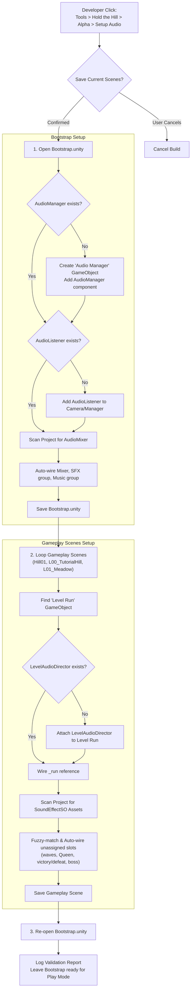

# Technical Documentation: AlphaAudioSetupBuilder.cs (Audio Scene Setup Tool)

**Target Unity Version**: Unity 6 (`6000.6.0f1`)  
**Context**: Editor Tools / Automated Scene Builders (*Hold the Hill*)  
**File Location**: `unity/Assets/_Game/Editor/AlphaAudioSetupBuilder.cs`  
**Namespace**: `HoldTheHill.EditorTools`  
**Assembly**: `HoldTheHill.Editor`  
**Menu Path**: `Tools > Hold the Hill > Alpha > Setup Audio (Manager and Directors)`  
**Companion Systems**:
- `AudioManager.cs` (`_Game/Core/Audio/`) — persistent playback service & mixer controller
- `LevelAudioDirector.cs` (`_Game/Features/GameFlow/Scripts/`) — run-level event audio observer
- `LevelRun.cs` (`_Game/Features/GameFlow/Scripts/`) — run state manager on the `Level Run` GameObject
- `AlphaRunFrameBuilder.cs` (`_Game/Editor/`) — scene component search utilities

---

## 1. Overview & Purpose

In *Hold the Hill*, scenes are split into additive layers (`Bootstrap`, `UI`, `Terrain`, and `Gameplay`). Manually configuring components across multiple scene files introduces human error and causes Git YAML merge conflicts.

Following project rule 3 in `AGENTS.md`:
> *"Generated scenes and prefabs are owned by their builder (`Tools > Hold the Hill > Alpha > Build ...`). Rerun the builder instead of hand-editing what it writes, and commit the rerun."*

`AlphaAudioSetupBuilder` provides a **single-click automated scene configuration tool** that sets up the persistent audio manager in `Bootstrap.unity` and wires `LevelAudioDirector` onto the `Level Run` object across all gameplay scenes.



---

## 2. Execution Workflow

When executed, the builder performs three sequential steps:

### Step 1: Persistent Bootstrap Configuration (`Bootstrap.unity`)
1. Opens `Assets/_Game/Scenes/Bootstrap.unity` in single mode.
2. Checks for an `AudioManager` using `AlphaRunFrameBuilder.FindInScene<AudioManager>(bootstrap)`. If missing, creates a GameObject named `Audio Manager` and attaches the component.
3. Checks for an active `AudioListener`. If none is found, adds one to the Bootstrap camera (or to the Audio Manager if no camera exists).
4. Searches the project's `AssetDatabase` for any `AudioMixer` asset (`t:AudioMixer`). If found and the manager's `_mixer` is unassigned, it auto-assigns the mixer and matches groups named `"SFX"` and `"Music"`.
5. Marks the scene dirty and saves `Bootstrap.unity`.

### Step 2: Level Director Configuration (Gameplay Scenes)
Iterates through all level gameplay scenes:
* `Assets/_Game/Scenes/Levels/Hill01/Hill01_Gameplay.unity`
* `Assets/_Game/Scenes/Levels/L00_TutorialHill/L00_TutorialHill_Gameplay.unity`
* `Assets/_Game/Scenes/Levels/L01_Meadow/L01_Meadow_Gameplay.unity`

For each scene:
1. Locates `LevelRun` in the hierarchy.
2. Checks for `LevelAudioDirector`. If missing, attaches it directly to the existing `Level Run` GameObject (or creates a dedicated host GameObject if no `LevelRun` is found).
3. Connects the serialized `_run` reference on the director.
4. Executes **fuzzy sound effect auto-wiring**: scans the project for `SoundEffectSO` assets and assigns unassigned slots based on asset naming conventions:

| Slot Property | Matching Search Patterns in Asset Name |
| :--- | :--- |
| `_waveStartedSfx` | `wave_start`, `wavestart` |
| `_waveCompletedSfx`| `wave_clear`, `waveclear`, `wave_complete` |
| `_queenDamagedSfx` | `queen_damage`, `queen_hurt`, `queendamage` |
| `_victorySfx` | `victory`, `win` |
| `_defeatSfx` | `defeat`, `lose`, `game_over` |
| `_bossAppearedSfx` | `boss`, `mantis` |
| `_centipedeSplitSfx`| `centipede`, `split` |
| `_towerPlacedSfx` | `tower_place`, `towerplace`, `place_tower` |

5. Marks the scene dirty and saves the level scene.

### Step 3: Verification & Reload
1. Re-opens `Bootstrap.unity`.
2. Inspects all saved scenes and compiles a status log string.
3. Logs a consolidated report to the Unity Console (e.g., `Audio Setup Complete: Bootstrap AudioManager = yes, AudioListener = yes, L00_TutorialHill_Gameplay Director = yes...`).
4. Leaves `Bootstrap.unity` open in the Editor, adhering to the project convention so pressing Play starts the full additive game loop.

---

## 3. Idempotency & Safety Features

* **Non-Destructive:** Safe to rerun multiple times. It checks `prop.objectReferenceValue == null` before assigning any reference, so manual customizations made by teammates are never overwritten.
* **No Duplicate Components:** Uses `FindInScene<T>()` before adding components to prevent multiple `AudioManager` or `LevelAudioDirector` instances from piling up.
* **Multi-Scene Prompting:** Calls `EditorSceneManager.SaveCurrentModifiedScenesIfUserWantsTo()` before beginning, ensuring any unsaved work in the Editor is preserved.

---

## 4. Automation & Batch Execution

The tool is declared with a public static entry point, enabling headless automation or CI execution:

```bash
Unity.exe -batchmode -quit -projectPath . -executeMethod HoldTheHill.EditorTools.AlphaAudioSetupBuilder.Build
```
