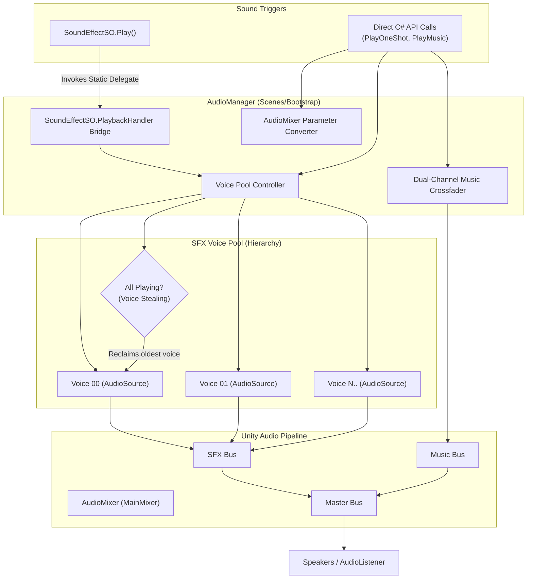
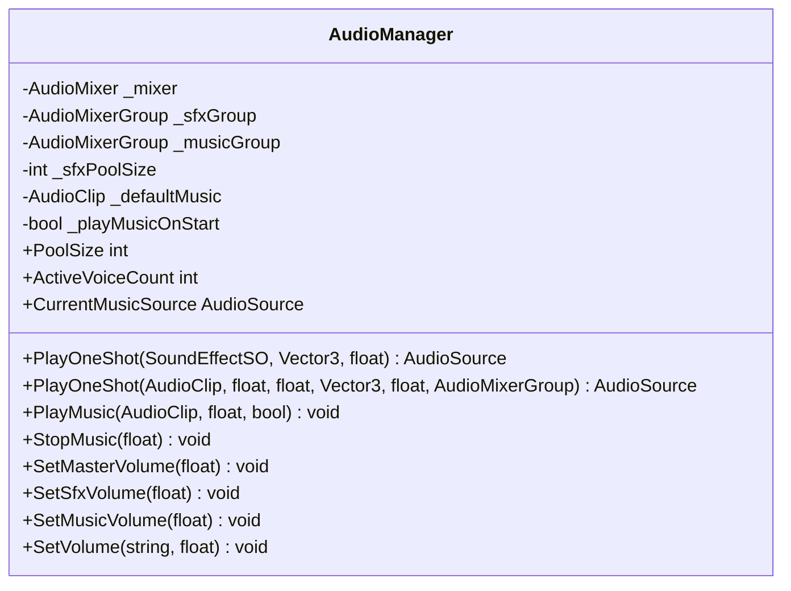

# Technical Documentation: AudioManager.cs (Audio Playback & Mixer Service)

**Target Unity Version**: Unity 6 (`6000.6.0f1`)  
**Context**: 2D Hybrid Tower Defense Game (*Hold the Hill*)  
**File Location**: `unity/Assets/_Game/Core/Audio/AudioManager.cs`  
**Namespace**: `HoldTheHill.Core.Audio`  
**Assembly**: `HoldTheHill.Runtime`  
**Test Suite**: `unity/Assets/_Game/Tests/EditMode/AudioManagerTests.cs`  
**Companion Systems**:
- `SoundEffectSO.cs` (`_Game/Core/Audio/`) — ScriptableObject audio event cards
- `LevelAudioDirector.cs` (`_Game/Features/GameFlow/Scripts/`) — macro run flow listener
- `SceneLoader.cs` (`_Game/Core/Bootstrap/`) — persistent scene bootstrap host

---

## 1. Overview & Architecture

`AudioManager` is the centralized playback engine and audio mixer controller for *Hold the Hill*. It provides a robust, zero-garbage-collection voice pool for sound effects, dual-source music cross-fading, and logarithmic volume attenuation for settings menus.

Rather than instantiating GameObjects or creating local `AudioSource` components on every projectile or enemy, all sound effects are dispatched through `AudioManager`'s pre-warmed voice pool.



### Architectural Highlights

1. **Automatic `SoundEffectSO` Binding:**
   In `OnEnable()`, `AudioManager` automatically registers its `PlayOneShot` method with `SoundEffectSO.PlaybackHandler`. Any call to `soundEffect.Play()` anywhere in the codebase immediately routes into the pool without requiring direct singleton calls.
2. **Pre-Warmed AudioSource Pooling (Zero GC):**
   Pre-allocates an array of `AudioSource` child components (default 16 voices). When a sound is triggered, an idle voice is allocated and recycled without heap allocation or GameObject instantiation.
3. **Voice Stealing Algorithm:**
   If all voices in the pool are actively playing during an intense combat wave, the manager identifies the voice with the highest normalized playback progress ($\frac{\text{time}}{\text{clip.length}}$), stops it, and repurposes it for the newest request. This ensures high-priority new sounds are never dropped.
4. **Dual-Channel Music Crossfading:**
   Maintains two dedicated `AudioSource` channels (`_musicSourceA` and `_musicSourceB`). Transitioning tracks fades out the active source while fading in the target source over a configurable duration using unscaled delta time (functional even when game simulation is paused).
5. **Logarithmic AudioMixer Decibel Math:**
   Exposes volume slider methods (`SetMasterVolume`, `SetSfxVolume`, `SetMusicVolume`) that translate linear UI slider values ($0.0$ to $1.0$) into logarithmic decibels:
   $$\text{dB} = 20 \times \log_{10}(\max(0.0001, \text{sliderValue}))$$
   This matches human hearing perception, ensuring a slider at $0.5$ sounds like half volume rather than muting abruptly.

---

## 2. Inspector Configuration & Fields



| Field | Type | Default | Attributes | Description |
| :--- | :--- | :--- | :--- | :--- |
| `_mixer` | `AudioMixer` | `null` | `[SerializeField]` | The master `AudioMixer` asset containing exposed volume parameters. |
| `_sfxGroup` | `AudioMixerGroup` | `null` | `[SerializeField]` | The default mixer bus routing for all pooled SFX voices. |
| `_musicGroup` | `AudioMixerGroup` | `null` | `[SerializeField]` | The mixer bus routing for background music channels A and B. |
| `_sfxPoolSize` | `int` | `16` | `[SerializeField]`, `[Min(4)]` | Total pre-warmed `AudioSource` voices created in the child pool. |
| `_defaultMusic` | `AudioClip` | `null` | `[SerializeField]` | Background track to trigger when the manager enables. |
| `_playMusicOnStart`| `bool` | `false`| `[SerializeField]` | Whether to automatically play `_defaultMusic` on `OnEnable()`. |

---

## 3. Runtime API Reference

### Accessors
* `AudioManager.Current`: Returns the active `AudioManager` in the scene (following the project's `SceneLoader.Current` pattern).
* `AudioManager.Instance`: Alias for `Current` for singleton compatibility.

### Playback Methods

#### `AudioSource PlayOneShot(SoundEffectSO sfx, Vector3 position = default, float spatialBlend = 0f)`
Pulls an available voice from the pool, extracts clip, pitch, volume, and mixer parameters from the `SoundEffectSO`, and plays the sound.
```csharp
[SerializeField] private SoundEffectSO _shootSfx;

// Direct invocation (or via _shootSfx.Play())
AudioManager.Current.PlayOneShot(_shootSfx, transform.position);
```

#### `AudioSource PlayOneShot(AudioClip clip, float volume = 1f, float pitch = 1f, Vector3 position = default, float spatialBlend = 0f, AudioMixerGroup group = null)`
Direct low-level overload for playing raw `AudioClip` instances without a ScriptableObject asset.

#### `void PlayMusic(AudioClip clip, float fadeDuration = 1f, bool loop = true)`
Cross-fades from the currently playing music track into `clip` over `fadeDuration` seconds. If the track is already playing, the call is ignored.
```csharp
// Cross-fade into combat wave theme over 1.5 seconds:
AudioManager.Current.PlayMusic(_waveCombatTrack, fadeDuration: 1.5f);
```

#### `void StopMusic(float fadeDuration = 1f)`
Fades out and stops any actively playing music track over `fadeDuration` seconds.

### Mixer Volume Controls
* `void SetMasterVolume(float linear01)`: Controls the `"MasterVolume"` parameter.
* `void SetSfxVolume(float linear01)`: Controls the `"SfxVolume"` parameter.
* `void SetMusicVolume(float linear01)`: Controls the `"MusicVolume"` parameter.
* `void SetVolume(string parameterName, float linear01)`: Generic method converting $0.0..1.0$ into $-80\text{ dB}..0\text{ dB}$.

---

## 4. Scene Setup & Bootstrap Hosting

`AudioManager` is intended to live on a GameObject in **`Scenes/Bootstrap`**, which remains loaded for the entire game session.

```
Scenes/Bootstrap
├── Scene Loader
├── Background Camera
└── Audio Manager
    └── SFX_VoicePool (Auto-generated child)
        ├── Voice_00
        ├── Voice_01
        └── ...
```

* **Domain Reload Protection:** Static instance references are automatically cleared via `[RuntimeInitializeOnLoadMethod(RuntimeInitializeLoadType.SubsystemRegistration)]` to ensure Play Mode runs safely.

---

## 5. Unit Testing & Verification

The component's core functionality is verified by [AudioManagerTests.cs](file:///c:/Users/metal/Documents/GitHub/HoldtheHill/HoldtheHill/unity/Assets/_Game/Tests/EditMode/AudioManagerTests.cs):

| Test Case | Description |
| :--- | :--- |
| `Awake_EstablishesCurrentInstance` | Verifies `AudioManager.Current` and `AudioManager.Instance` are assigned on Awake. |
| `OnEnable_RegistersPlaybackHandler` | Asserts that `SoundEffectSO.PlaybackHandler` is hooked when the manager enables. |
| `OnDisable_UnregistersPlaybackHandler` | Asserts that `SoundEffectSO.PlaybackHandler` is safely nulled on disable. |
| `PlayOneShot_RawClip_ConfiguresAudioSource` | Confirms pooled voice properties (clip, pitch, volume, position, spatial blend). |
| `PlayOneShot_SoundEffectSO_RoutesThroughPlaybackHandler` | Verifies end-to-end routing from `sfx.Play()` into the pooled voice manager. |
| `PlayMusic_AssignsClipToMusicSource` | Confirms assignment and looping configuration on the music channel. |
| `SetVolume_HandlesNullMixerGracefully` | Verifies null-safety of volume methods when running in headless tests without an AudioMixer. |
