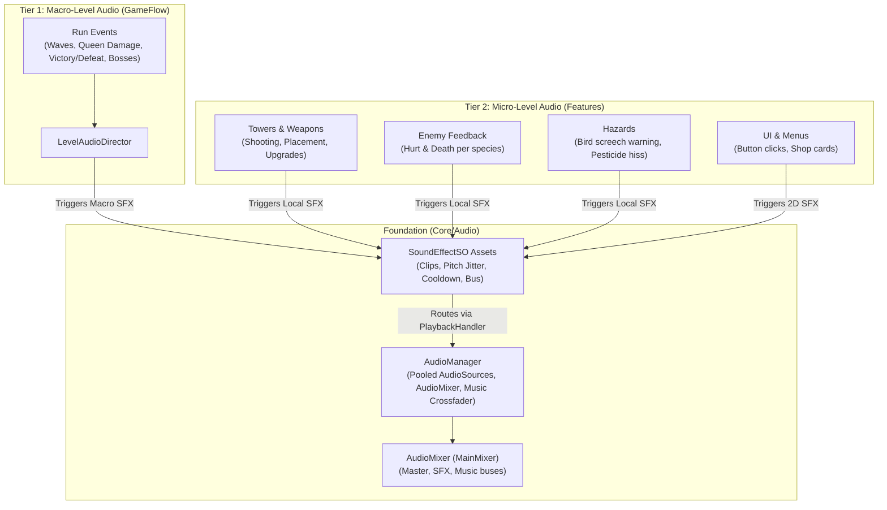

# Technical Documentation: Audio System Setup Guide (Macro & Micro Audio)

**Target Unity Version**: Unity 6 (`6000.6.0f1`)  
**Context**: 2D Hybrid Tower Defense Game (*Hold the Hill*)  
**File Location**: `Documentation/AudioSetup_Documentation.md`  
**Related Components**:
- `SoundEffectSO.cs` (`_Game/Core/Audio/`) — data assets defining clip parameters
- `AudioManager.cs` (`_Game/Core/Audio/`) — centralized voice pool & mixer engine
- `LevelAudioDirector.cs` (`_Game/Features/GameFlow/Scripts/`) — macro run flow listener
- `AlphaAudioSetupBuilder.cs` (`_Game/Editor/`) — automated scene setup tool

---

## 1. Overview: The Hybrid Audio Architecture

*Hold the Hill* uses a **two-tier hybrid audio architecture (Approach D)** to balance modularity, team productivity, and audio clarity:



### The Two Audio Tiers
1. **Macro-Level Audio (Run Flow & Pacing):**
   * **What it is:** Global game milestones that affect the entire screen.
   * **Examples:** Wave started, wave completed, Queen taking damage, victory fanfare, defeat sting, boss arrivals.
   * **How it is handled:** A single centralized observer ([LevelAudioDirector.cs](file:///c:/Users/metal/Documents/GitHub/HoldtheHill/HoldtheHill/unity/Assets/_Game/Features/GameFlow/Scripts/LevelAudioDirector.cs)) listens to existing game events and triggers macro sound assets.
2. **Micro-Level Audio (Entity-Specific Feedback):**
   * **What it is:** Localized, high-frequency, species- or weapon-specific feedback.
   * **Examples:** Archer arrow whoosh vs. Catapult lob, Silverfish crunch vs. Rhino metallic thud, bird shadow screech telegraph, UI button clicks.
   * **How it is handled:** Embedded directly onto feature prefabs and data cards via serialized [SoundEffectSO](file:///c:/Users/metal/Documents/GitHub/HoldtheHill/HoldtheHill/unity/Assets/_Game/Core/Audio/SoundEffectSO.cs) asset references.

---

## 2. Asset Pipeline & Conventions

### File Formats & Git LFS
* **Sound Effects (SFX):** Uncompressed `.wav` (low latency, fast decompression).
* **Music & Ambience:** Compressed `.ogg` (streamed, smaller memory footprint).
* **Git LFS:** All `.wav`, `.mp3`, and `.ogg` files are automatically tracked by Git LFS per [`.gitattributes`](file:///c:/Users/metal/Documents/GitHub/HoldtheHill/HoldtheHill/.gitattributes#L28-L30).

### Naming Conventions
Follow the industry standard naming rules established in [CONVENTIONS.md](file:///c:/Users/metal/Documents/GitHub/HoldtheHill/HoldtheHill/docs/CONVENTIONS.md#L43):
* **Sound Effects:** `sfx_<category>_<action>_<variant>.wav` (e.g. `sfx_tower_arrow_01.wav`, `sfx_hazard_bird_01.wav`)
* **UI Audio:** `ui_<action>.wav` (e.g. `ui_click_01.wav`, `ui_error_01.wav`)
* **Music:** `mus_<scene/level>_<track>.ogg` (e.g. `mus_L01_waves.ogg`, `mus_home.ogg`)

### Folder Structure
* Shared / Cross-feature audio: `unity/Assets/_Game/Shared/Audio/SFX/` and `Shared/Audio/Music/`
* Feature-specific audio: `unity/Assets/_Game/Features/<Feature>/Audio/` (e.g. `Features/Towers/Audio/`)
* Sound Effect data assets: `unity/Assets/_Game/Shared/Audio/Data/` or `Features/<Feature>/Data/`

---

## 3. Creating a `SoundEffectSO` Asset

Before wiring any sound into gameplay, create its `SoundEffectSO` asset card:

1. In the Unity Project window, navigate to your feature's data folder (or `_Game/Shared/Audio/Data/`).
2. Right-click $\rightarrow$ **Create > Hold the Hill > Audio > Sound Effect** (prefix with `sfx_`).
3. Configure the asset in the Inspector:
   * **Audio Clips:** Add 1 to 4 clip variations. The asset randomly cycles through them without playing the same clip twice in succession.
   * **Mixer Group:** Assign the `SFX` bus from `MainMixer.mixer` (used for both gameplay and UI sounds; if left unassigned, `AudioManager` falls back to its `_sfxGroup`).
   * **Volume:** Set base gain ($0.0$ to $1.0$).
   * **Pitch Variance:** Set jitter bounds centered at $1.0$ (e.g. `X: 0.95`, `Y: 1.05`). This gives organic variety to repeated sounds.
   * **Cooldown:** Set anti-spam threshold (recommended $0.05\text{s}$ for combat impacts, $0.5\text{s}$ for wave chimes) to prevent audio stacking and distortion.
   * **Spatial Blend:** Set to `0.0` for 2D stereo (UI and global alerts) or `0.2`–`0.4` for world-space combat.

---

## 4. Macro-Level Setup Process

Macro sounds are managed by `LevelAudioDirector` and cover game-wide milestones.

### Method A: Automated Setup via Editor Builder (Recommended)
1. In the Unity Editor, click:  
   **`Tools > Hold the Hill > Alpha > Setup Audio (Manager and Directors)`**
2. The builder automatically:
   * Adds `AudioManager` and an `AudioListener` to `Bootstrap.unity`.
   * Auto-wires the `AudioMixer` asset if present.
   * Attaches `LevelAudioDirector` to the `Level Run` GameObject in all level gameplay scenes.
   * Scans for matching `SoundEffectSO` assets (matching names like `wave_start`, `queen_damage`, etc.) and auto-assigns unassigned slots.
3. Saves all scenes and leaves `Bootstrap.unity` open ready for Play mode.

### File Names Automatically Matched by AlphaAudioSetupBuilder

When running `Tools > Hold the Hill > Alpha > Setup Audio (Manager and Directors)`, the builder scans the project using `AssetDatabase.FindAssets` and automatically populates any unassigned slots on `LevelAudioDirector` and `AudioManager`.

Matching is **case-insensitive** (using `ToLowerInvariant()`) and uses **substring containment** (`name.Contains(...)`). As long as your `SoundEffectSO` asset filename contains one of the recognized substrings, it will be automatically discovered and wired into the corresponding slot:

#### 1. Level Audio Director (`SoundEffectSO` Slots)

| Director Slot Property | Substring Keywords Matched | Recommended Asset Filename (`SoundEffectSO`) | Companion Audio Clip (`.wav`) | Trigger Event |
| :--- | :--- | :--- | :--- | :--- |
| `_waveStartedSfx` | `wave_start`<br>`wavestart` | `sfx_wave_start.asset`<br>`sfx_wavestart.asset`<br>`sfx_wave_start_01.asset` | `sfx_wave_start_01.wav` | Wave begins spawning (`EnemySpawner.onWaveStarted`) |
| `_waveCompletedSfx` | `wave_clear`<br>`waveclear`<br>`wave_complete` | `sfx_wave_clear.asset`<br>`sfx_waveclear.asset`<br>`sfx_wave_complete.asset` | `sfx_wave_clear_01.wav` | Wave defeated & cooldown starts (`EnemySpawner.onWaveCleared`) |
| `_queenDamagedSfx` | `queen_damage`<br>`queen_hurt`<br>`queendamage` | `sfx_queen_damage.asset`<br>`sfx_queen_hurt.asset`<br>`sfx_queendamage.asset` | `sfx_queen_damage_01.wav`<br>`sfx_queen_damage_02.wav` | Queen takes damage from arriving enemies (`Queen.HealthChanged`) |
| `_victorySfx` | `victory`<br>`win` | `sfx_victory.asset`<br>`sfx_win.asset`<br>`sfx_victory_fanfare.asset` | `sfx_victory_01.wav` | Level cleared with Queen intact (`LevelRun.Finished` with `Won`) |
| `_defeatSfx` | `defeat`<br>`lose`<br>`game_over` | `sfx_defeat.asset`<br>`sfx_lose.asset`<br>`sfx_game_over.asset` | `sfx_defeat_01.wav` | Queen health reaches 0 (`LevelRun.Finished` with `Lost`) |
| `_bossAppearedSfx` | `boss`<br>`mantis` | `sfx_boss_appear.asset`<br>`sfx_mantis_appear.asset`<br>`sfx_boss_intro.asset` | `sfx_boss_appear_01.wav` | Boss enemy spawns into level (`BasicEnemy.OnAnyEnemiesSpawned`) |
| `_centipedeSplitSfx` | `centipede`<br>`split` | `sfx_centipede_split.asset`<br>`sfx_split.asset`<br>`sfx_centipede_divide.asset` | `sfx_centipede_split_01.wav` | Centipede divides into child segments (`CentipedeEnemy.OnAnyCentipedeSplit`) |
| `_towerPlacedSfx` | `tower_place`<br>`towerplace`<br>`place_tower` | `sfx_tower_place.asset`<br>`sfx_towerplace.asset`<br>`sfx_place_tower.asset` | `sfx_tower_place_01.wav`<br>`sfx_tower_place_02.wav` | Tower placed on the grid (`TowerPlacer.TowerPlaced`) |

#### 2. Audio Manager (`AudioMixer` & Buses)

| Manager Slot Property | Asset Query Filter | Matched Asset / Group Name | Purpose |
| :--- | :--- | :--- | :--- |
| `_mixer` | `Assets/_Game/Shared/Audio/MainMixer.mixer` (fallback `t:AudioMixer` in `Assets/_Game`) | `MainMixer.mixer` | Primary AudioMixer controlling volume attenuation |
| `_sfxGroup` | `mixer.FindMatchingGroups("SFX")` | AudioMixerGroup named `SFX` | Sound effects & UI bus routed to `AudioManager` and shared `SoundEffectSO` assets |
| `_musicGroup` | `mixer.FindMatchingGroups("Music")` | AudioMixerGroup named `Music` | Music bus routed to `AudioManager` |

> [!NOTE]
> **Key Rules for Automatic Matching:**
> - **ScriptableObject Assets Only:** The builder searches for serialized `SoundEffectSO` assets (`.asset`), not raw `.wav` clips. Create the `.asset` card first via **Create > Hold the Hill > Audio > Sound Effect** and assign your `.wav` clip(s) to it.
> - **Non-Destructive:** The builder never overwrites a slot that is already assigned (`prop.objectReferenceValue == null`). If you manually assigned a custom asset, your selection is preserved.
> - **First Match Wins:** If multiple assets match the same keyword, the first match encountered in `AssetDatabase.FindAssets` is bound. To prevent ambiguity, use the recommended naming patterns above in `Assets/_Game/Shared/Audio/Data/`.

### Method B: Manual Setup in Level Scenes
If configuring by hand in a level gameplay scene:
1. Open the level's gameplay scene (e.g. `L00_TutorialHill_Gameplay.unity`).
2. Select the **`Level Run`** GameObject in the Hierarchy.
3. Add the **`LevelAudioDirector`** component.
4. Drag the `LevelRun` component on that same GameObject into the `_run` slot.
5. Assign your `SoundEffectSO` assets into the respective slots:
   * `_waveStartedSfx`
   * `_waveCompletedSfx`
   * `_queenDamagedSfx`
   * `_victorySfx`
   * `_defeatSfx`
   * `_bossAppearedSfx`
   * `_centipedeSplitSfx`
   * `_towerPlacedSfx`

---

## 5. Micro-Level Setup Process

Micro sounds give distinct personalities to specific towers, enemy species, hazards, and UI controls.

### Pattern 1: UI Button Audio
To make any UI button play a click sound:
```csharp
using HoldTheHill.Core.Audio;
using UnityEngine;
using UnityEngine.UI;

namespace HoldTheHill.Features.UI
{
    [RequireComponent(typeof(Button))]
    public class UIButtonAudio : MonoBehaviour
    {
        [SerializeField] private SoundEffectSO _clickSfx;

        private void Awake()
        {
            GetComponent<Button>().onClick.AddListener(PlayClick);
        }

        private void PlayClick()
        {
            _clickSfx?.Play(); // Plays in 2D stereo
        }
    }
}
```
Attach `UIButtonAudio` to any button in `Scenes/UI` and assign `ui_click.asset`.

---

### Pattern 2: Enemy Hurt & Death Feedback
To give an enemy species unique impact and squish audio, hook into `EnemyHurtAndDeath.cs`:
```csharp
// Inside EnemyHurtAndDeath.cs:
[Header("Audio")]
[SerializeField] private SoundEffectSO _hurtSfx;
[SerializeField] private SoundEffectSO _deathSfx;

public void PlayHurtAudio()
{
    _hurtSfx?.Play(transform.position);
}

public void PlayDeathAudio()
{
    _deathSfx?.Play(transform.position);
}
```
* **Rhino Beetle:** Assign a metallic clank sound.
* **Silverfish:** Assign a crisp crunch / paper tear sound.
* **Centipede:** Assign a snapping / chitin break sound.

---

### Pattern 3: Tower Weapon & Projectile Firing
Towers or projectiles trigger localized audio on attack or impact:
```csharp
// Inside Tower weapon or Projectile script:
[SerializeField] private SoundEffectSO _shootSfx;

public void Attack(Vector3 targetPosition)
{
    // Play localized shooting sound at tower position:
    _shootSfx?.Play(transform.position);

    // Spawn projectile...
}
```

---

### Pattern 4: Hazard Telegraph Warnings
Hazards must provide audible telegraphs so players have time to burrow towers before impact:
```csharp
// Inside BirdShadow.cs:
[SerializeField] private SoundEffectSO _screechWarningSfx;

private void Start()
{
    // Warn player as the bird enters the screen:
    _screechWarningSfx?.Play();
}
```

---

## 6. AudioMixer & Volume Controls

The `AudioManager` connects player volume preferences to Unity's `AudioMixer` (`Assets/_Game/Shared/Audio/MainMixer.mixer`):

1. **Hierarchy (3 Buses):**
   * `Master` (Master volume attenuation; exposed parameter `MasterVolume`)
     * `SFX` (Gameplay sound effects and UI audio; exposed parameter `SfxVolume`)
     * `Music` (Background music channels; exposed parameter `MusicVolume`)
2. **Settings Sliders & Persistence:**
   Connect UI sliders directly to `AudioManager`:
   * Master Slider $\rightarrow$ `AudioManager.Current.SetMasterVolume(slider.value)`
   * SFX Slider $\rightarrow$ `AudioManager.Current.SetSfxVolume(slider.value)`
   * Music Slider $\rightarrow$ `AudioManager.Current.SetMusicVolume(slider.value)`
   Values are mapped logarithmically to decibels ($0.0 \rightarrow -80\text{ dB}$, $1.0 \rightarrow 0\text{ dB}$), persisted in `PlayerPrefs` (`Awake()` load, `Start()` mixer application after DSP initialization), and stored separately from `AudioManager._musicVolume` so the base music trim is preserved without double attenuation.

---

## 7. Troubleshooting & Best Practices Checklist

| Issue | Likely Cause | Fix |
| :--- | :--- | :--- |
| **Sound does not play** | Missing `AudioManager` in scene | Ensure `Bootstrap.unity` has an `AudioManager` or run `Tools > Hold the Hill > Alpha > Setup Audio`. |
| **Sound does not play in test scene** | No `PlaybackHandler` registered | `SoundEffectSO` automatically falls back to `AudioSource.PlayClipAtPoint` if no manager is present, or pass a local `AudioSource` to `sfx.Play(source)`. |
| **Multiple identical sounds trigger at once** | Cooldown is set to 0 | Increase `_cooldown` on the `SoundEffectSO` asset (e.g. $0.05\text{s}$–$0.1\text{s}$). |
| **Enemy death sound cuts off abruptly** | Sound played on an `AudioSource` attached to the dying enemy | Use `SoundEffectSO.Play(transform.position)`. This routes to the pooled `AudioManager`, which outlives the destroyed enemy GameObject. |
| **"There are 2 audio listeners in the scene" warning** | Duplicate `AudioListener` | Ensure only the persistent camera (or `Bootstrap` audio manager) has an `AudioListener`. Remove extra listeners from additive level scenes. |
| **Music doesn't play while paused** | Crossfader relies on `Time.deltaTime` | `AudioManager` uses `Time.unscaledDeltaTime` so music fades and transitions continue smoothly during pause menus. |
