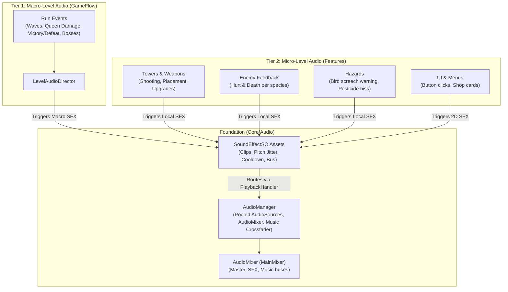

# Technical Documentation: Audio System Setup Guide (Macro & Micro Audio)

**Target Unity Version**: Unity 6 (`6000.6.0f1`)  
**Context**: 2D Hybrid Tower Defense Game (*Hold the Hill*)  
**File Location**: `Documentation/AudioSetup_Documentation.md`  
**Related Components**:
- `SoundEffectSO.cs` (`_Game/Core/Audio/`) — data assets defining clip parameters
- `AudioManager.cs` (`_Game/Core/Audio/`) — centralized voice pool & mixer engine
- `LevelAudioDirector.cs` (`_Game/Features/GameFlow/Scripts/`) — macro run flow listener
- `AlphaAudioSetupBuilder.cs` (`_Game/Editor/`) — automated scene setup tool

---

## 1. Overview: The Hybrid Audio Architecture

*Hold the Hill* uses a **two-tier hybrid audio architecture (Approach D)** to balance modularity, team productivity, and audio clarity:



### The Two Audio Tiers
1. **Macro-Level Audio (Run Flow & Pacing):**
   * **What it is:** Global game milestones that affect the entire screen.
   * **Examples:** Wave started, wave completed, Queen taking damage, victory fanfare, defeat sting, boss arrivals.
   * **How it is handled:** A single centralized observer ([LevelAudioDirector.cs](file:///c:/Users/metal/Documents/GitHub/HoldtheHill/HoldtheHill/unity/Assets/_Game/Features/GameFlow/Scripts/LevelAudioDirector.cs)) listens to existing game events and triggers macro sound assets.
2. **Micro-Level Audio (Entity-Specific Feedback):**
   * **What it is:** Localized, high-frequency, species- or weapon-specific feedback.
   * **Examples:** Archer arrow whoosh vs. Catapult lob, Silverfish crunch vs. Rhino metallic thud, bird shadow screech telegraph, UI button clicks.
   * **How it is handled:** Embedded directly onto feature prefabs and data cards via serialized [SoundEffectSO](file:///c:/Users/metal/Documents/GitHub/HoldtheHill/HoldtheHill/unity/Assets/_Game/Core/Audio/SoundEffectSO.cs) asset references.

---

## 2. Asset Pipeline & Conventions

### File Formats & Git LFS
* **Sound Effects (SFX):** Uncompressed `.wav` (low latency, fast decompression).
* **Music & Ambience:** Compressed `.ogg` (streamed, smaller memory footprint).
* **Git LFS:** All `.wav`, `.mp3`, and `.ogg` files are automatically tracked by Git LFS per [`.gitattributes`](file:///c:/Users/metal/Documents/GitHub/HoldtheHill/HoldtheHill/.gitattributes#L28-L30).

### Naming Conventions
Follow the industry standard naming rules established in [CONVENTIONS.md](file:///c:/Users/metal/Documents/GitHub/HoldtheHill/HoldtheHill/docs/CONVENTIONS.md#L43):
* **Sound Effects:** `sfx_<category>_<action>_<variant>.wav` (e.g. `sfx_tower_arrow_01.wav`, `sfx_hazard_bird_01.wav`)
* **UI Audio:** `ui_<action>.wav` (e.g. `ui_click_01.wav`, `ui_error_01.wav`)
* **Music:** `mus_<scene/level>_<track>.ogg` (e.g. `mus_L01_waves.ogg`, `mus_home.ogg`)

### Folder Structure
* Shared / Cross-feature audio: `unity/Assets/_Game/Shared/Audio/SFX/` and `Shared/Audio/Music/`
* Feature-specific audio: `unity/Assets/_Game/Features/<Feature>/Audio/` (e.g. `Features/Towers/Audio/`)
* Sound Effect data assets: `unity/Assets/_Game/Shared/Audio/Data/` or `Features/<Feature>/Data/`

---

## 3. Creating a `SoundEffectSO` Asset

Before wiring any sound into gameplay, create its `SoundEffectSO` asset card:

1. In the Unity Project window, navigate to your feature's data folder (or `_Game/Shared/Audio/Data/`).
2. Right-click $\rightarrow$ **Create > Hold the Hill > Audio > Sound Effect** (prefix with `sfx_`).
3. Configure the asset in the Inspector:
   * **Audio Clips:** Add 1 to 4 clip variations. The asset randomly cycles through them without playing the same clip twice in succession.
   * **Mixer Group:** Assign the target bus (`SFX` or `UI`).
   * **Volume:** Set base gain ($0.0$ to $1.0$).
   * **Pitch Variance:** Set jitter bounds centered at $1.0$ (e.g. `X: 0.95`, `Y: 1.05`). This gives organic variety to repeated sounds.
   * **Cooldown:** Set anti-spam threshold (recommended $0.05\text{s}$ for combat impacts, $0.5\text{s}$ for wave chimes) to prevent audio stacking and distortion.
   * **Spatial Blend:** Set to `0.0` for 2D stereo (UI and global alerts) or `0.2`–`0.4` for world-space combat.

---

## 4. Macro-Level Setup Process

Macro sounds are managed by `LevelAudioDirector` and cover game-wide milestones.

### Method A: Automated Setup via Editor Builder (Recommended)
1. In the Unity Editor, click:  
   **`Tools > Hold the Hill > Alpha > Setup Audio (Manager and Directors)`**
2. The builder automatically:
   * Adds `AudioManager` and an `AudioListener` to `Bootstrap.unity`.
   * Auto-wires the `AudioMixer` asset if present.
   * Attaches `LevelAudioDirector` to the `Level Run` GameObject in all level gameplay scenes.
   * Scans for matching `SoundEffectSO` assets (matching names like `wave_start`, `queen_damage`, etc.) and auto-assigns unassigned slots.
3. Saves all scenes and leaves `Bootstrap.unity` open ready for Play mode.

### Method B: Manual Setup in Level Scenes
If configuring by hand in a level gameplay scene:
1. Open the level's gameplay scene (e.g. `L00_TutorialHill_Gameplay.unity`).
2. Select the **`Level Run`** GameObject in the Hierarchy.
3. Add the **`LevelAudioDirector`** component.
4. Drag the `LevelRun` component on that same GameObject into the `_run` slot.
5. Assign your `SoundEffectSO` assets into the respective slots:
   * `_waveStartedSfx`
   * `_waveCompletedSfx`
   * `_queenDamagedSfx`
   * `_victorySfx`
   * `_defeatSfx`
   * `_bossAppearedSfx`
   * `_centipedeSplitSfx`
   * `_towerPlacedSfx`

---

## 5. Micro-Level Setup Process

Micro sounds give distinct personalities to specific towers, enemy species, hazards, and UI controls.

### Pattern 1: UI Button Audio
To make any UI button play a click sound:
```csharp
using HoldTheHill.Core.Audio;
using UnityEngine;
using UnityEngine.UI;

namespace HoldTheHill.Features.UI
{
    [RequireComponent(typeof(Button))]
    public class UIButtonAudio : MonoBehaviour
    {
        [SerializeField] private SoundEffectSO _clickSfx;

        private void Awake()
        {
            GetComponent<Button>().onClick.AddListener(PlayClick);
        }

        private void PlayClick()
        {
            _clickSfx?.Play(); // Plays in 2D stereo
        }
    }
}
```
Attach `UIButtonAudio` to any button in `Scenes/UI` and assign `ui_click.asset`.

---

### Pattern 2: Enemy Hurt & Death Feedback
To give an enemy species unique impact and squish audio, hook into `EnemyHurtAndDeath.cs`:
```csharp
// Inside EnemyHurtAndDeath.cs:
[Header("Audio")]
[SerializeField] private SoundEffectSO _hurtSfx;
[SerializeField] private SoundEffectSO _deathSfx;

public void PlayHurtAudio()
{
    _hurtSfx?.Play(transform.position);
}

public void PlayDeathAudio()
{
    _deathSfx?.Play(transform.position);
}
```
* **Rhino Beetle:** Assign a metallic clank sound.
* **Silverfish:** Assign a crisp crunch / paper tear sound.
* **Centipede:** Assign a snapping / chitin break sound.

---

### Pattern 3: Tower Weapon & Projectile Firing
Towers or projectiles trigger localized audio on attack or impact:
```csharp
// Inside Tower weapon or Projectile script:
[SerializeField] private SoundEffectSO _shootSfx;

public void Attack(Vector3 targetPosition)
{
    // Play localized shooting sound at tower position:
    _shootSfx?.Play(transform.position);

    // Spawn projectile...
}
```

---

### Pattern 4: Hazard Telegraph Warnings
Hazards must provide audible telegraphs so players have time to burrow towers before impact:
```csharp
// Inside BirdShadow.cs:
[SerializeField] private SoundEffectSO _screechWarningSfx;

private void Start()
{
    // Warn player as the bird enters the screen:
    _screechWarningSfx?.Play();
}
```

---

## 6. AudioMixer & Volume Controls

The `AudioManager` connects player volume preferences to Unity's `AudioMixer`:

1. **Hierarchy:**
   * `Master` (Master volume attenuation)
     * `SFX` (Sound effects bus)
     * `Music` (Background music bus)
2. **Settings Sliders:**
   Connect UI sliders directly to `AudioManager`:
   * Master Slider $\rightarrow$ `AudioManager.Current.SetMasterVolume(slider.value)`
   * SFX Slider $\rightarrow$ `AudioManager.Current.SetSfxVolume(slider.value)`
   * Music Slider $\rightarrow$ `AudioManager.Current.SetMusicVolume(slider.value)`
   Values are automatically mapped to decibels logarithmically ($0.0 \rightarrow -80\text{ dB}$, $1.0 \rightarrow 0\text{ dB}$).

---

## 7. Troubleshooting & Best Practices Checklist

| Issue | Likely Cause | Fix |
| :--- | :--- | :--- |
| **Sound does not play** | Missing `AudioManager` in scene | Ensure `Bootstrap.unity` has an `AudioManager` or run `Tools > Hold the Hill > Alpha > Setup Audio`. |
| **Sound does not play in test scene** | No `PlaybackHandler` registered | `SoundEffectSO` automatically falls back to `AudioSource.PlayClipAtPoint` if no manager is present, or pass a local `AudioSource` to `sfx.Play(source)`. |
| **Multiple identical sounds trigger at once** | Cooldown is set to 0 | Increase `_cooldown` on the `SoundEffectSO` asset (e.g. $0.05\text{s}$–$0.1\text{s}$). |
| **Enemy death sound cuts off abruptly** | Sound played on an `AudioSource` attached to the dying enemy | Use `SoundEffectSO.Play(transform.position)`. This routes to the pooled `AudioManager`, which outlives the destroyed enemy GameObject. |
| **"There are 2 audio listeners in the scene" warning** | Duplicate `AudioListener` | Ensure only the persistent camera (or `Bootstrap` audio manager) has an `AudioListener`. Remove extra listeners from additive level scenes. |
| **Music doesn't play while paused** | Crossfader relies on `Time.deltaTime` | `AudioManager` uses `Time.unscaledDeltaTime` so music fades and transitions continue smoothly during pause menus. |
