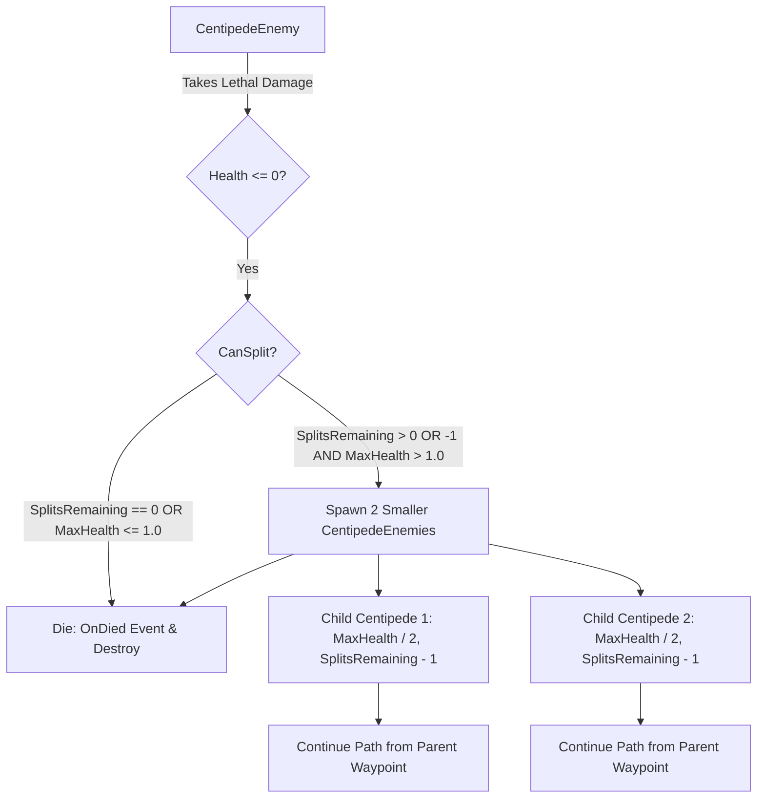

# Technical Documentation: CentipedeEnemy.cs

**Target Unity Version**: Unity 6 (`6000.6.0f1`)  
**Context**: 2D Hybrid Tower Defense Game  
**File Location**: `Hold the Hill/unity/Assets/_Game/Features/Enemies/Scripts/EnemySubclasses/CentipedeEnemy.cs`  
**Companion Files**: 
- `Hold the Hill/unity/Assets/_Game/Features/Enemies/Scripts/Basic Enemy/BasicEnemy.cs`
- `Hold the Hill/unity/Assets/_Game/Tests/EditMode/CentipedeEnemyTests.cs`

---

## 1. Overview & Architecture

`CentipedeEnemy` is a specialized subclass of `BasicEnemy`. The signature gameplay mechanic of the Centipede is its recursive splitting behavior: upon defeat, it divides into 2 smaller child enemies, each starting with half of the parent's maximum health pool.

These child enemies continue to traverse the assigned path from the parent's death point and waypoint progress. If defeated, each child will split again upon reaching 0 HP until they only have 1 HP remaining (at which point they die permanently). Additionally, designers can configure a `_splitsRemaining` counter to strictly cap how many times the enemy can split (-1 allows splitting recursively until the 1 HP condition is reached).



### Key Architectural Pillars
- **Inheritance & Reusability**: Inherits all baseline navigation, health management, sprite flipping, and destination handling from `BasicEnemy`.
- **Recursive Splitting Mechanic**: Automatically halves `MaxHealth` for children, reduces visual scale (`_sizeMultiplier`), and spawns the first child at the parent's position and the second child 1 unit forward along the path.
- **Strict Splitting Constraints**:
  - **1 HP Terminal Condition**: Splitting halts if the enemy has 1 HP or less, or if halving would produce less than 1 HP.
  - **Splits Remaining Counter**: Decrements with each split generation. When it reaches 0, no further splitting occurs. `-1` allows infinite splits until the 1 HP condition.
- **Path Continuity**: Child units inherit the parent's waypoint coordinates and appropriate waypoint progress (advancing waypoints when crossing corners), ensuring they seamlessly advance along the path without retracing previous waypoints.
- **Decoupled Events**: Employs `OnSplit` (instance) and `OnAnyCentipedeSplit` (static) events for audio, particle effects, and spawner wave tracking.

---

## 2. Inspector Fields Reference

In addition to all fields inherited from `BasicEnemy` (`_maxHealth`, `_damage`, `_moveSpeed`, etc.), `CentipedeEnemy` exposes specialized splitting configuration:

### Centipede Splitting Fields
| Field | Type | Default | Description |
| :--- | :--- | :--- | :--- |
| `_splitsRemaining` | `int` | `-1` | Maximum remaining split generations. Decrements with each split. Set to `-1` for unlimited splits until the 1 HP threshold is reached. |
| `_splitPrefab` | `GameObject` | `null` | Optional prefab to instantiate for child segments. If left `null`, a clone of the current GameObject is instantiated. |
| `_sizeMultiplier` | `float` | `0.8` | Visual scale multiplier applied to `transform.localScale` of child enemies upon splitting. |
| `_splitForwardDistance` | `float` | `1.0` | Distance forward along the path where the second child enemy is spawned. |

---

## 3. Public API Reference

### Properties

| Property | Type | Access | Description |
| :--- | :--- | :--- | :--- |
| `SplitsRemaining` | `int` | `get / set` | Counter controlling remaining splits (-1 for unlimited until 1 HP). |
| `SizeMultiplier` | `float` | `get / set` | Visual scale factor applied to child segments upon splitting. |
| `SplitForwardDistance` | `float` | `get / set` | Forward distance along the path for the second spawned child. |
| `SplitOffsetDistance` | `float` | `get / set` | Backward-compatible alias for `SplitForwardDistance`. |
| `SplitPrefab` | `GameObject` | `get / set` | Prefab template for child segments (or `null` to self-clone). |

### C# Events

```csharp
public event Action<CentipedeEnemy, List<CentipedeEnemy>> OnSplit;
public static event Action<CentipedeEnemy, List<CentipedeEnemy>> OnAnyCentipedeSplit;
```

---

### Methods

#### `public bool CanSplit()`
- **Returns**: `true` if `_splitsRemaining` is `-1` or `> 0`, AND `MaxHealth > 1.0` and `MaxHealth / 2.0 >= 1.0`. Otherwise `false`.

#### `public Vector3 CalculatePositionAlongPath(float forwardDistance, out int targetWaypointIndex)`
- **Description**: Advances along the remaining path waypoints (handling corners and turns) by `forwardDistance` and outputs the appropriate target waypoint index.
- **Returns**: The calculated world position.

#### `public List<CentipedeEnemy> Split()`
- **Description**: Instantiates 2 child enemies with `MaxHealth / 2.0`, decrements `SplitsRemaining` (unless `-1`), applies visual scaling, spawns the first child at the original position and the second child forward along the path, assigns path coordinates and waypoint progress, and invokes `OnSplit` events.
- **Returns**: List containing the 2 newly spawned child enemies.

#### `protected override void Die()`
- **Description**: Called when health drops to 0. Checks `CanSplit()` and invokes `Split()` if eligible before executing the base death sequence (`base.Die()`).

---

## 4. Setup & Usage

### Creating a Centipede Enemy Prefab
1. In the Unity Hierarchy, create a 2D GameObject (or duplicate an existing enemy prefab variant).
2. Attach a `SpriteRenderer` with the centipede sprite and a `Collider2D` (e.g. `CircleCollider2D` or `CapsuleCollider2D`) set to `Is Trigger = true`.
3. Attach the `CentipedeEnemy` component.
4. Configure initial stats:
   - **Max Health**: e.g. `8.0` (will split: 8 -> 4 -> 2 -> 1).
   - **Move Speed**: e.g. `2.5`.
   - **Damage**: e.g. `1`.
   - **Splits Remaining**: `-1` (or e.g. `2` to limit to two split generations).
   - **Size Multiplier**: `0.8`.
   - **Split Forward Distance**: `1.0`.
5. Save as a prefab in `Assets/_Game/Features/Enemies/Prefabs/CentipedeEnemy.prefab`.

6. Add the prefab entry into `MapWaveDataSO` waves in `EnemySpawner`.
