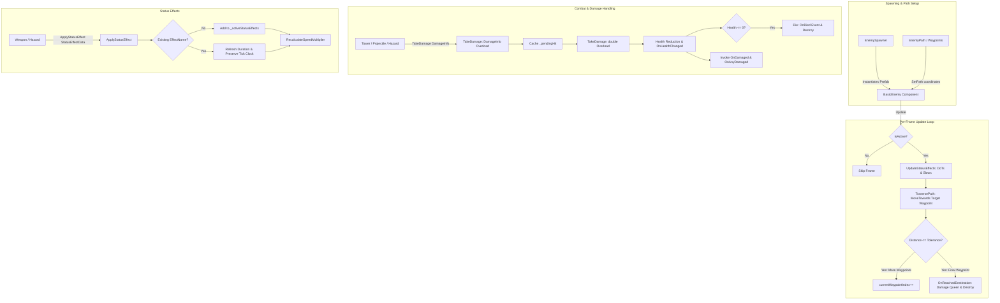

# Technical Documentation: BasicEnemy.cs (Enemy Scripts)

**Target Unity Version**: Unity 6 (`6000.6.0f1`)  
**Context**: 2D Hybrid Tower Defense Game  
**File Location**: `Hold the Hill/unity/Assets/_Game/Features/Enemies/Scripts/Basic Enemy/BasicEnemy.cs`  
**Companion Files**: 
- `Hold the Hill/unity/Assets/_Game/Features/Combat/Scripts/IDamageable.cs`
- `Hold the Hill/unity/Assets/_Game/Features/Combat/Scripts/IHealthReadable.cs`
- `Hold the Hill/unity/Assets/_Game/Features/Combat/Scripts/DamageInfo.cs`
- `Hold the Hill/unity/Assets/_Game/Features/Combat/Scripts/StatusEffectData.cs`
- `Hold the Hill/unity/Assets/_Game/Features/Combat/Scripts/CombatUtil.cs`
- `Hold the Hill/unity/Assets/_Game/Features/Enemies/Scripts/EnemyPath.cs`
- `Hold the Hill/unity/Assets/_Game/Features/Enemies/Scripts/EnemySpawner/EnemySpawner.cs`
- `Hold the Hill/unity/Assets/_Game/Tests/EditMode/BasicEnemyTests.cs`

---

## 1. Overview & Architecture

`BasicEnemy` is the core foundation for all enemy entities in *Hold the Hill*. It implements the combat contracts [`IDamageable`](file:///c:/Users/metal/Documents/HoldtheHill/HoldtheHill/unity/Assets/_Game/Features/Combat/Scripts/IDamageable.cs) and [`IHealthReadable`](file:///c:/Users/metal/Documents/HoldtheHill/HoldtheHill/unity/Assets/_Game/Features/Combat/Scripts/IHealthReadable.cs), manages health and damage mitigation, processes active status effects (slows and poison damage-over-time), provides route-based path traversal, handles knockback, and exposes extensive lifecycle events for decoupled game systems.

It is designed to fulfill two architectural roles simultaneously:
1. **Concrete Runtime Component**: Can be attached directly to baseline enemy prefabs (such as basic ants or grunts) with stats configured through the Unity Inspector.
2. **Extensible Superclass**: Serves as the base class for specialized enemy variants (e.g., [`SilverfishEnemy`](file:///c:/Users/metal/Documents/HoldtheHill/HoldtheHill/unity/Assets/_Game/Features/Enemies/Scripts/EnemySubclasses/SilverfishEnemy.cs), [`CentipedeEnemy`](file:///c:/Users/metal/Documents/HoldtheHill/HoldtheHill/unity/Assets/_Game/Features/Enemies/Scripts/EnemySubclasses/CentipedeEnemy.cs), armored beetles, flying units) by providing virtual hooks for lifecycle events, custom damage mitigation, and death reactions.



### Key Architectural Pillars

- **Combat Interface Compliance (`IDamageable`, `IHealthReadable`)**: Seamlessly interfaces with towers, projectiles, and hazards without tight coupling. Exposes `Transform` directly for aiming and provides `float` health properties for tower targeting heuristics (`Strongest` / `Weakest`).
- **Strict Separation of Active Lifecycle (`IsActive`)**: The `IsActive` property (`!IsDead && !ReachedEnd`) prevents edge cases where an enemy reaching the Queen or dying could still receive hits, trigger bounties, or split into duplicate child segments during the same frame.
- **Dynamic Status Effect Management**: Maintains active slows and damage-over-time (DoT) instances. Multiple effects with the same identifier refresh their duration rather than stacking, and slow multipliers calculate the strongest active slow cleanly.
- **Subclass-Safe Damage Pipeline**: The `TakeDamage(DamageInfo)` interface method delegates into `TakeDamage(double)` while tracking `_pendingHit`. This guarantees subclasses overriding `TakeDamage(double)` (e.g., armor reduction or shield absorption) intercept all damage while preserving full hit metadata for `OnDamaged` events.
- **Path Continuity & Knockback**: Supports coordinate-based movement in 2D with waypoint progression, backward knockback that correctly traces back through previous waypoints, and SpriteRenderer auto-flipping.
- **Decoupled Architecture with Static & Instance Events**: Broadly dispatches both instance and static events (`OnAnyDamaged`, `OnAnyDied`, `OnAnyDestinationReached`, `OnAnyEnemiesSpawned`) so HUD meters, combat counters, and spawners stay decoupled.
- **Domain Reload & Subsystem Registration**: Resets static event delegates on domain reload to prevent orphaned listeners between Play Mode sessions.

---

## 2. Inspector Fields Reference

`BasicEnemy` organizes its serialized fields into clear Inspector categories:

```
[DisallowMultipleComponent]
```

### Health & Combat
| Field | Type | Default | Description |
| :--- | :--- | :--- | :--- |
| `_maxHealth` | `double` | `100.0` | Maximum health pool of the enemy. Initialized to `_currentHealth` in `Awake()`. |
| `_damage` | `int` | `1` | Attack power of this enemy inflicted on the hill / Queen upon reaching the destination. |

### Path & Movement
| Field | Type | Default | Description |
| :--- | :--- | :--- | :--- |
| `_moveSpeed` | `float` | `2.0` | Movement speed along the path in world units per second. Clamped to $\ge 0$. |
| `_waypointTolerance` | `float` | `0.05` | Distance threshold in world units to consider a waypoint coordinate reached. |
| `_pathCoordinates` | `List<Vector3>` | `Empty` | Ordered world coordinates defining the route. Can be pre-assigned in the Inspector or assigned dynamically at runtime via `SetPath()`. |

### Visuals
| Field | Type | Default | Description |
| :--- | :--- | :--- | :--- |
| `_flipSpriteFacing` | `bool` | `true` | If `true` and a `SpriteRenderer` is found (on self or a child), flips `flipX` automatically when moving left (`direction.x < 0`). |

---

## 3. Public API Reference

### Properties

| Property | Type | Access | Description |
| :--- | :--- | :--- | :--- |
| `MaxHealth` | `double` | `get` | Returns the maximum health pool. |
| `CurrentHealth` | `double` | `get` | Returns the current health value. |
| `Damage` | `int` | `get / set` | Attack power of the enemy. |
| `MoveSpeed` | `float` | `get / set` | Movement speed in world units per second (clamped to $\ge 0$). |
| `SpeedMultiplier` | `float` | `get` | Current movement multiplier from active status effects (`0.0` to `1.0`). |
| `PathCoordinates` | `IReadOnlyList<Vector3>` | `get` | Read-only view of the world coordinates the enemy is traversing. |
| `CurrentWaypointIndex` | `int` | `get / set` | Zero-based index of the target waypoint currently being pursued (clamped to $\ge 0$). |
| `IsDead` | `bool` | `get / protected set` | `true` if health has dropped to zero and the death sequence has triggered. |
| `ReachedEnd` | `bool` | `get / protected set` | `true` if the enemy reached the final waypoint (the Queen). Once true, the enemy is excluded from combat interactions. |
| `IsActive` | `bool` | `get` | `true` only when `!IsDead && !ReachedEnd`. Used as a guard across all combat and movement operations. |
| `Transform` | `Transform` | `get` | Satisfies `IDamageable.Transform`, returning `transform` for aiming and distance queries. |
| `IHealthReadable.CurrentHealth` | `float` | `explicit get` | Returns `(float)_currentHealth` for tower priority evaluations (`Strongest` / `Weakest`). |
| `IHealthReadable.MaxHealth` | `float` | `explicit get` | Returns `(float)_maxHealth` for tower priority evaluations. |

---

### C# Events

`BasicEnemy` provides both instance events (for components attached directly to or observing this specific enemy) and static events (for global systems like HUD, audio managers, spawners, and tower credit):

#### Instance Events
```csharp
public event Action<BasicEnemy> OnDied;
public event Action<BasicEnemy> OnDestinationReached;
public event Action<double, double> OnHealthChanged; // (currentHealth, maxHealth)
public event Action<BasicEnemy, DamageInfo, float> OnDamaged; // (enemy, hitInfo, appliedDamage)
```

#### Static Events
```csharp
public static event Action<BasicEnemy> OnAnyDied;
public static event Action<BasicEnemy> OnEnemyDied; // Backwards-compatible alias for OnAnyDied
public static event Action<BasicEnemy> OnAnyDestinationReached;
public static event Action<BasicEnemy, DamageInfo, float> OnAnyDamaged;
public static event Action<int> OnAnyEnemiesSpawned;
```

* `OnDied` / `OnAnyDied`: Raised when health reaches 0 before destruction.
* `OnDestinationReached` / `OnAnyDestinationReached`: Raised when reaching the final waypoint coordinate.
* `OnHealthChanged`: Raised whenever health changes via `TakeDamage`, `Heal`, or `SetMaxHealth`.
* `OnDamaged` / `OnAnyDamaged`: Raised on every hit with full `DamageInfo` and actual applied damage (useful for damage popups, hit flashes, and tower credit).
* `OnAnyEnemiesSpawned`: Fired when split segments or summoned minions are spawned outside the standard spawner (invoked via `NotifyEnemiesSpawned`).

---

### Public Methods

#### Damage & Combat Methods

##### `void TakeDamage(DamageInfo info)`
```csharp
public virtual void TakeDamage(DamageInfo info)
```
- **Description**: Primary combat entry point implementing `IDamageable.TakeDamage`. Validates that the enemy is active (`IsActive`) and damage amount is positive.
- **Subclass Safety**: Caches `info` in `_pendingHit` and calls `TakeDamage((double)info.Amount)`, ensuring subclasses that override `TakeDamage(double)` intercept the hit while retaining hit details for `OnDamaged` events.

##### `void TakeDamage(double damageAmount)`
```csharp
public virtual void TakeDamage(double damageAmount)
```
- **Description**: Applies raw damage directly. Subtracts health, invokes `OnHealthChanged`, and triggers `Die()` if health reaches zero. Constructs a fallback `DamageInfo` if none was pending, and fires `OnDamaged` and `OnAnyDamaged` with the exact damage applied.

##### `void Heal(double healAmount)`
```csharp
public virtual void Heal(double healAmount)
```
- **Description**: Restores health up to `_maxHealth` and invokes `OnHealthChanged`. Ignored if non-positive or inactive.

##### `void SetMaxHealth(double newMaxHealth, bool resetCurrentHealth = true)`
```csharp
public virtual void SetMaxHealth(double newMaxHealth, bool resetCurrentHealth = true)
```
- **Description**: Adjusts `_maxHealth` dynamically (e.g. for wave scaling or difficulty modifiers). If `resetCurrentHealth` is true, restores `_currentHealth` to the new maximum; otherwise clamps current health to the new maximum.

---

#### Status Effects Methods

##### `void ApplyStatusEffect(StatusEffectData status)`
```csharp
public virtual void ApplyStatusEffect(StatusEffectData status)
```
- **Description**: Implements `IDamageable.ApplyStatusEffect`. If an effect with the same `EffectName` already exists, refreshes its remaining duration and preserves its tick clock. If new, registers the effect and recalculates `SpeedMultiplier`.

##### `virtual void UpdateStatusEffects(float deltaTime)`
```csharp
public virtual void UpdateStatusEffects(float deltaTime)
```
- **Description**: Ticks all active status effects. For DoT effects whose tick timer expires, deals damage using `TakeDamage(new DamageInfo(..., DamageType.Poison))`. Cleans up expired effects and triggers `RecalculateSpeedMultiplier()`.

---

#### Movement & Path Methods

##### `void SetPath(IEnumerable<Vector3> coordinates, bool teleportToStart = false)`
- **Description**: Clears existing path coordinates, sets new 3D world coordinates, and resets `_currentWaypointIndex` to `0`. If `teleportToStart` is true, snaps position to the first coordinate.

##### `void SetPath(IEnumerable<Vector3> coordinates, int startingWaypointIndex, bool teleportToStart = false)`
- **Description**: Assigns path coordinates and starts progression at a specific waypoint index. Essential for spawned child segments (like centipede splits) so they resume progression at their parent's position without walking back to the beginning.

##### `void SetPath(IEnumerable<Vector2> coordinates, bool teleportToStart = false)`
- **Description**: 2D coordinate overload converting `Vector2` coordinates into `Vector3` while preserving the enemy's current Z coordinate.

##### `void SetPath(EnemyPath enemyPath, bool teleportToStart = false)`
- **Description**: Extracts waypoints directly from an [`EnemyPath`](file:///c:/Users/metal/Documents/HoldtheHill/HoldtheHill/unity/Assets/_Game/Features/Enemies/Scripts/EnemyPath.cs) component.

##### `virtual void Knockback(float distance)`
```csharp
public virtual void Knockback(float distance)
```
- **Description**: Pushes the enemy backward along its route by the specified distance in world units. Accurately traverses backwards across multiple waypoint corners if knockback distance exceeds the distance to the previous waypoint, decrementing `_currentWaypointIndex`.

##### `void ReachDestination()`
- **Description**: Manually forces the enemy to trigger its destination reached logic (damaging base and destroying self).

---

#### Static Utilities

##### `static void NotifyEnemiesSpawned(int count)`
```csharp
public static void NotifyEnemiesSpawned(int count)
```
- **Description**: Raises `OnAnyEnemiesSpawned` to notify external systems (such as `EnemySpawner` living enemy tracking) that new enemies entered the field outside the spawner's wave loop.

---

## 4. Lifecycle & Internal Mechanics

### Lifecycle Flow
1. **`Awake()`**: Initializes `_currentHealth = _maxHealth`, sets `_speedMultiplier = 1f`, and obtains a reference to the `SpriteRenderer` (via `GetComponentInChildren<SpriteRenderer>()`).
2. **`Start()`**: If no path coordinates have been assigned, automatically queries the scene for an [`EnemyPath`](file:///c:/Users/metal/Documents/HoldtheHill/HoldtheHill/unity/Assets/_Game/Features/Enemies/Scripts/EnemyPath.cs) and initializes the route.
3. **`Update()`**:
   * Checks `IsActive` (returns if dead or already at destination).
   * Calls `UpdateStatusEffects(Time.deltaTime)`.
   * Re-checks `IsActive` (in case a DoT tick was lethal).
   * Calls `TraversePath()`.
4. **`OnDisable()`**: Clears active status effects and resets `_speedMultiplier = 1f`.
5. **`ResetStaticEvents()`**: Decorated with `[RuntimeInitializeOnLoadMethod(SubsystemRegistration)]`. Automatically wipes all static event subscriptions upon domain reload or entering Play Mode.

### Destruction Handling (`DestroySelf`)
To allow unit tests in `EditMode` to verify enemy deaths without throwing Unity exceptions, destruction is routed through `DestroySelf()`:
```csharp
protected void DestroySelf()
{
    if (Application.isPlaying)
        Destroy(gameObject);
    else
        DestroyImmediate(gameObject);
}
```

---

## 5. Extensibility & Subclassing Guide

All core behaviors are declared as `virtual`. Subclasses can override any step of the enemy lifecycle:

```csharp
namespace HoldTheHill.Features.Enemies
{
    public class ArmoredEnemy : BasicEnemy
    {
        [Header("Armor Settings")]
        [SerializeField] private double _flatArmor = 5.0;

        public override void TakeDamage(double damageAmount)
        {
            // Intercepts hits from both TakeDamage(DamageInfo) and TakeDamage(double)
            double mitigatedDamage = System.Math.Max(1.0, damageAmount - _flatArmor);
            base.TakeDamage(mitigatedDamage);
        }

        protected override void Die()
        {
            // Custom armor shatter VFX before base cleanup
            SpawnArmorShatterVfx();
            base.Die();
        }
    }
}
```

### List of Overridable Hooks
* `Awake()`, `Start()`, `Update()`, `OnDisable()`
* `TakeDamage(DamageInfo info)` & `TakeDamage(double damageAmount)`
* `ApplyStatusEffect(StatusEffectData status)` & `UpdateStatusEffects(float deltaTime)`
* `RecalculateSpeedMultiplier()`
* `TraversePath()` & `UpdateFacing(Vector3 direction)`
* `Knockback(float distance)`
* `Heal(double healAmount)` & `SetMaxHealth(...)`
* `OnReachedDestination()` & `Die()`

---

## 6. Integration With Other Systems

| System / Component | Integration Mechanism | Details |
| :--- | :--- | :--- |
| **`IDamageable` / Towers** | Interface call | Towers identify enemies via `CombatUtil.OverlapDamageables` and call `TakeDamage(DamageInfo)`. Towers aim toward `enemy.Transform`. |
| **`IHealthReadable` / Tower AI** | Interface query | Towers targeting `Strongest` or `Weakest` inspect `((IHealthReadable)enemy).CurrentHealth`. |
| **`Queen` / Base Objective** | Event subscription | `Queen` subscribes to `BasicEnemy.OnAnyDestinationReached` and deducts `enemy.Damage` from base health. |
| **`EnemySpawner`** | Event subscription | Tracks active enemy populations by listening to `OnAnyEnemiesSpawned`, `OnAnyDied`, and `OnAnyDestinationReached`. |
| **Status Effects / Hazards** | Direct interaction | Ground hazards (e.g. sap, poison puddles) call `ApplyStatusEffect(StatusEffectData)`. |
| **Hit Feedback & Audio** | Event observation | VFX controllers observe `OnDamaged` / `OnAnyDamaged` to trigger flash shaders, hit sounds, and damage numbers. |
