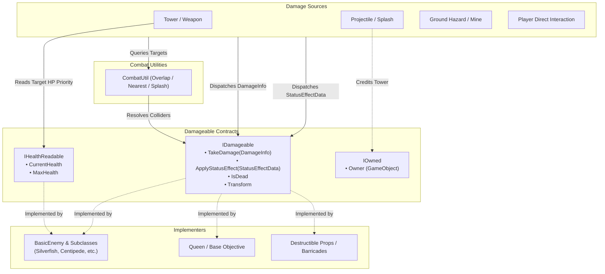

# Technical Documentation: IDamageable.cs (Damageable Interfaces)

**Target Unity Version**: Unity 6 (`6000.6.0f1`)  
**Context**: 2D Hybrid Tower Defense Game  
**File Location**: `Hold the Hill/unity/Assets/_Game/Features/Combat/Scripts/IDamageable.cs`  
**Companion Files**: 
- `Hold the Hill/unity/Assets/_Game/Features/Combat/Scripts/IHealthReadable.cs`
- `Hold the Hill/unity/Assets/_Game/Features/Combat/Scripts/IOwned.cs`
- `Hold the Hill/unity/Assets/_Game/Features/Combat/Scripts/DamageInfo.cs`
- `Hold the Hill/unity/Assets/_Game/Features/Combat/Scripts/StatusEffectData.cs`
- `Hold the Hill/unity/Assets/_Game/Features/Combat/Scripts/CombatUtil.cs`
- `Hold the Hill/unity/Assets/_Game/Features/Enemies/Scripts/Basic Enemy/BasicEnemy.cs`

---

## 1. Overview & Architecture

`IDamageable` is the foundational combat interface in *Hold the Hill*. It establishes a strictly decoupled contract between entities that inflict damage or status effects (towers, projectiles, ground hazards, player clicks) and entities that receive them (enemies, bosses, destructible obstacles, the player's base/Queen).

By relying on `IDamageable` rather than concrete classes like `BasicEnemy` or `Queen`, weapons and damage systems remain completely agnostic of the specific behaviors, movement mechanics, or health implementations of their targets.



### Key Architectural Pillars

- **Pure Decoupled Contract**: Attackers never require references to concrete enemy types. A projectile simply checks for `IDamageable` on impact.
- **Segregation of Health Reading (`IHealthReadable`)**: Inflicting damage does not inherently require knowing how much health an entity has left. `IHealthReadable` is kept as a separate interface used strictly by targeting heuristics (e.g., towers configured to prioritize "Strongest" or "Weakest" targets). Entities without meaningful numeric health bars (such as hit-count shields or invulnerable destructibles) can implement `IDamageable` without being forced to expose artificial health values.
- **Zero-Allocation Data Structs**: Damage hits occur hundreds of times per second during heavy enemy waves. `DamageInfo` and `StatusEffectData` are declared as `struct` types to eliminate garbage collector (GC) allocations during gameplay.
- **Unified Spatial Reference**: Exposing `Transform Transform { get; }` directly on `IDamageable` avoids repetitive `(target as Component).transform` casting or expensive `GetComponent<Transform>()` lookups during targeting, homing projectile guidance, and distance checks.
- **Lifecycle Guarding**: The `bool IsDead { get; }` property guarantees that targeting systems and projectile colliders can immediately bypass entities that are playing death animations, awaiting destruction, or already depleted of health.

---

## 2. Interface Definitions & Member Details

### `IDamageable` Interface
Located in: `HoldTheHill.Features.Combat`

```csharp
namespace HoldTheHill.Features.Combat
{
    public interface IDamageable
    {
        void TakeDamage(DamageInfo info);
        void ApplyStatusEffect(StatusEffectData status);
        bool IsDead { get; }
        Transform Transform { get; }
    }
}
```

| Member | Type | Access | Description |
| :--- | :--- | :--- | :--- |
| `TakeDamage(DamageInfo info)` | `void` | Method | Applies a hit payload to the target. The implementer calculates damage mitigation, resistances, shield absorption, and triggers death sequences if health drops to zero or below. |
| `ApplyStatusEffect(StatusEffectData status)` | `void` | Method | Applies a periodic damage-over-time (DoT) or movement speed slow to the target. Re-applying an effect with the same `EffectName` refreshes its duration rather than stacking indefinitely. |
| `IsDead` | `bool` | Property (`get`) | Returns `true` once the entity's health pool is exhausted or its death sequence has begun. Targeting algorithms must skip any target reporting `IsDead == true`. |
| `Transform` | `Transform` | Property (`get`) | The Unity `Transform` component representing the target's world position, used for distance comparisons, tower aiming, and projectile homing. |

---

### Companion Interface: `IHealthReadable`
Located in: `HoldTheHill.Features.Combat`

```csharp
namespace HoldTheHill.Features.Combat
{
    public interface IHealthReadable
    {
        float CurrentHealth { get; }
        float MaxHealth { get; }
    }
}
```

| Member | Type | Access | Description |
| :--- | :--- | :--- | :--- |
| `CurrentHealth` | `float` | Property (`get`) | Current remaining health pool of the entity. |
| `MaxHealth` | `float` | Property (`get`) | Maximum total health pool of the entity. |

**Usage**: Used by tower targeting algorithms when evaluating `TargetPriority.Strongest` or `TargetPriority.Weakest`. If a detected `IDamageable` does not implement `IHealthReadable`, the tower gracefully falls back to distance or progress ordering.

---

### Companion Interface: `IOwned`
Located in: `HoldTheHill.Features.Combat`

```csharp
namespace HoldTheHill.Features.Combat
{
    public interface IOwned
    {
        GameObject Owner { get; }
    }
}
```

| Member | Type | Access | Description |
| :--- | :--- | :--- | :--- |
| `Owner` | `GameObject` | Property (`get`) | The originator entity (e.g., the specific Tower instance) to which damage dealt, kill credit, experience, or bounties should be attributed. |

**Usage**: Implemented by projectiles, cluster fragments, and ground hazards. When an enemy dies from damage dealt by a loose projectile, the combat system inspects `info.Source` via `CombatUtil.OwnerOf(info.Source)` to properly award the kill or damage score to the originating tower rather than the transient projectile prefab.

---

## 3. Data Structs Reference

### `DamageInfo`
Located in: `HoldTheHill.Features.Combat` (`DamageInfo.cs`)

`DamageInfo` encapsulates an atomic instance of damage being delivered from a source to a target.

```csharp
public struct DamageInfo
{
    public float Amount;
    public GameObject Source;
    public Vector2 HitPoint;
    public DamageType Type;
    public bool IsCritical;

    public DamageInfo(float amount, GameObject source, Vector2 hitPoint, DamageType type = DamageType.Physical)
    {
        Amount = amount;
        Source = source;
        HitPoint = hitPoint;
        Type = type;
        IsCritical = false;
    }
}
```

| Field | Type | Description |
| :--- | :--- | :--- |
| `Amount` | `float` | Raw damage value before any defensive mitigation or target resistances are applied. |
| `Source` | `GameObject` | The GameObject that initiated the attack (e.g., the firing Tower or loose Projectile). Can be `null` if the instigator was destroyed before impact. |
| `HitPoint` | `Vector2` | World coordinate where the hit landed. Used for particle effects, damage numbers, and knockback direction calculations. |
| `Type` | `DamageType` | The elemental or physical category of the hit (see `DamageType` below). Targets inspect this to apply armor, shields, or elemental resistances. |
| `IsCritical` | `bool` | Flags whether the hit rolled a critical strike, modifying floating combat text visuals and multiplier effects. |

#### `DamageType` Enum
- `Physical`: Standard kinetic damage (arrows, bites, blunt strikes).
- `Magic`: Energy attacks (arcane blasts, mystical auras).
- `True`: Unmitigated damage that bypasses all armor, shields, and resistances.
- `Fire`: Thermal damage, often accompanied by burning DoTs.
- `Poison`: Chemical/toxin damage, often associated with debilitating status effects.
- `Lightning`: Shock damage, frequently utilized in chain-lightning attacks.

---

### `StatusEffectData`
Located in: `HoldTheHill.Features.Combat` (`StatusEffectData.cs`)

A serializable struct configuring damage-over-time (DoT) and movement slowdown effects applied via `IDamageable.ApplyStatusEffect`.

| Field / Property | Type | Description |
| :--- | :--- | :--- |
| `EffectName` | `string` | Unique identifier for the status effect. Applying an effect with an identical name refreshes the active duration instead of stacking multiple instances. |
| `DamagePerTick` | `float` | Damage applied to the target on each tick interval. Set to `0` for pure movement slows. (`[Min(0)]`) |
| `TickInterval` | `float` | Elapsed seconds between consecutive DoT ticks. (`[Min(0)]`) |
| `Duration` | `float` | Total lifespan of the effect in seconds. A duration of `0` or less marks the effect as inactive. (`[Min(0)]`) |
| `SlowMultiplier` | `float` | Multiplier applied to target movement speed while active. `1.0` = normal speed (no slow), `0.5` = half speed. (`[Range(0f, 1f)]`) |
| `IsValid` | `bool` (`get`) | Evaluates whether the effect has a non-zero duration and either deals damage or applies a slow (`Duration > 0 && (DamagePerTick > 0 || SlowMultiplier < 1)`). |
| `SafeTickInterval` | `float` (`get`) | Returns `TickInterval` clamped to a safe non-zero divisor (`TickInterval > 0.01f ? TickInterval : 1f`). |
| `StatusEffectData.None` | `StatusEffectData` (static `get`) | Convenience empty effect with `SlowMultiplier = 1f` and `Duration = 0f` to indicate "no effect". |

---

## 4. Critical Unity Engine Rules & Gotchas

### 1. The Unity Object Null-Check Trap: Use `CombatUtil.IsAlive`
In Unity, `UnityEngine.Object` overloads the `==` and `!=` operators so that destroyed game objects compare equal to `null`. However, **C# interface references do not invoke Unity's custom equality operators**. 

If you store an `IDamageable` reference and check:
```csharp
// DANGEROUS IN UNITY:
if (target != null && !target.IsDead)
{
    target.TakeDamage(info); // Throws MissingReferenceException if the GameObject was destroyed!
}
```
If the underlying `MonoBehaviour` was destroyed by Unity during the frame, the C# reference is technically not `null`, allowing execution to pass the check and crash with a `MissingReferenceException`.

**Solution**: Always use `CombatUtil.IsAlive(IDamageable target)`:
```csharp
// SAFE:
if (CombatUtil.IsAlive(target))
{
    target.TakeDamage(info);
}
```
`CombatUtil.IsAlive` explicitly casts the interface back to `UnityEngine.Object` to invoke Unity's underlying life check:
```csharp
public static bool IsAlive(IDamageable target)
{
    if (target is Object unityObj && unityObj == null)
    {
        return false;
    }
    return target != null && !target.IsDead && target.Transform != null;
}
```

### 2. Collider Resolution with Child Objects
Enemies often place their `Collider2D` components on child game objects (e.g., dedicated hitboxes or sprite sub-objects) while the logic component (`BasicEnemy`) resides on the root GameObject.
- Never assume `collider.GetComponent<IDamageable>()` will find the target.
- Use `CombatUtil.TryGetDamageable(Collider2D collider, out IDamageable damageable)`, which internally calls `collider.GetComponentInParent<IDamageable>()` and verifies `IsAlive`.

### 3. Direct Hits vs. Splash Damage (`ignore` Parameter)
When a projectile impacts an enemy and detonates an area-of-effect (AoE) splash:
1. The projectile applies direct single-target damage to the primary target via `primaryTarget.TakeDamage(directInfo)`.
2. When invoking `CombatUtil.ApplySplash(...)`, pass the primary target into the `ignore` parameter:
   ```csharp
   CombatUtil.ApplySplash(center, splashRadius, mask, splashDamage, DamageType.Fire, source, status, ignore: primaryTarget);
   ```
   Omitting `ignore` causes the primary target to erroneously take both direct hit damage and splash damage from the same attack.

---

## 5. Step-by-Step Implementation Guide

To make any new entity damageable (such as a new enemy type, barricade, or base objective):

### Step 1: Implement `IDamageable` and `IHealthReadable`
Create a `MonoBehaviour` script and implement the required members:

```csharp
using UnityEngine;
using HoldTheHill.Features.Combat;

namespace HoldTheHill.Features.Barricades
{
    [RequireComponent(typeof(Collider2D))]
    public class DestructibleBarricade : MonoBehaviour, IDamageable, IHealthReadable
    {
        [SerializeField] private float _maxHealth = 200f;
        private float _currentHealth;
        private bool _isDead;

        public bool IsDead => _isDead;
        public Transform Transform => transform;
        public float CurrentHealth => _currentHealth;
        public float MaxHealth => _maxHealth;

        private void Awake()
        {
            _currentHealth = _maxHealth;
        }

        public void TakeDamage(DamageInfo info)
        {
            if (_isDead) return;

            // Apply damage mitigation / calculation
            _currentHealth = Mathf.Max(0f, _currentHealth - info.Amount);

            if (_currentHealth <= 0f)
            {
                Die();
            }
        }

        public void ApplyStatusEffect(StatusEffectData status)
        {
            if (_isDead || !status.IsValid) return;

            // Stationary barricades ignore movement slows, but can process DoT ticks
            // Handle DoT or status refresh logic here
        }

        private void Die()
        {
            _isDead = true;
            // Play destruction VFX / SFX
            Destroy(gameObject);
        }
    }
}
```

### Step 2: Configure Physics and Layers
1. Add a `Collider2D` (e.g., `BoxCollider2D` or `CircleCollider2D`) to the GameObject.
2. Ensure the GameObject is assigned to an appropriate layer (e.g., `Default`, `Enemies`, or `Interactable`) included in tower targeting layer masks (`_targetMask`).
3. If the object moves, ensure a `Rigidbody2D` is attached (typically kinematic for waypoint-based enemies).

---

## 6. Implementers & Consumers Across the Project

| Component / System | Role | Integration Details |
| :--- | :--- | :--- |
| `BasicEnemy` | Primary Implementer | Implements `IDamageable` and `IHealthReadable`. Handles armor mitigation, active DoT timers, movement slow multipliers, and dispatches `OnDied` / `OnHealthChanged` events. |
| `SilverfishEnemy` | Implementer Subclass | Inherits `BasicEnemy`. Intercepts player clicks via `OnMouseDown` to apply instant lethal `TakeDamage`. |
| `CentipedeEnemy` | Implementer Subclass | Inherits `BasicEnemy`. On lethal damage, intercepts death to recursively spawn split child segments. |
| `CombatUtil` | Core Query Utility | Provides `OverlapDamageables`, `NearestDamageable`, `TryGetDamageable`, and `ApplySplash` using non-allocating static buffers. |
| `Tower` / `TowerWeapon` | Primary Consumer | Gathers target lists using `OverlapDamageables`, sorts targets by health using `IHealthReadable`, and calls `TakeDamage`. |
| `Projectile` / `RicochetProjectile` | Consumer & Implementer | Delivers `DamageInfo` on collision; implements `IOwned` to attribute damage to the parent tower. |
| `GroundHazard` / `ProximityMine` | Consumer & Implementer | Detects overlapping `IDamageable` entities and applies area damage and `StatusEffectData`. |
| `BasicEnemyTests` | Test Suite | EditMode unit tests verifying that all enemy subclasses adhere to the `IDamageable` and `IHealthReadable` contracts. |

