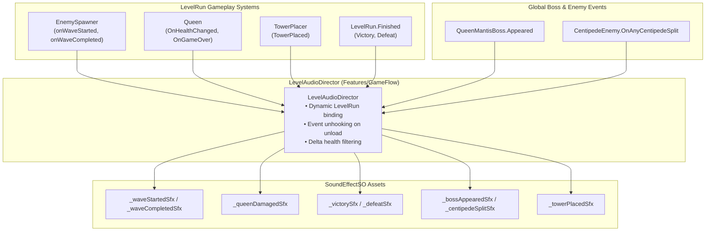
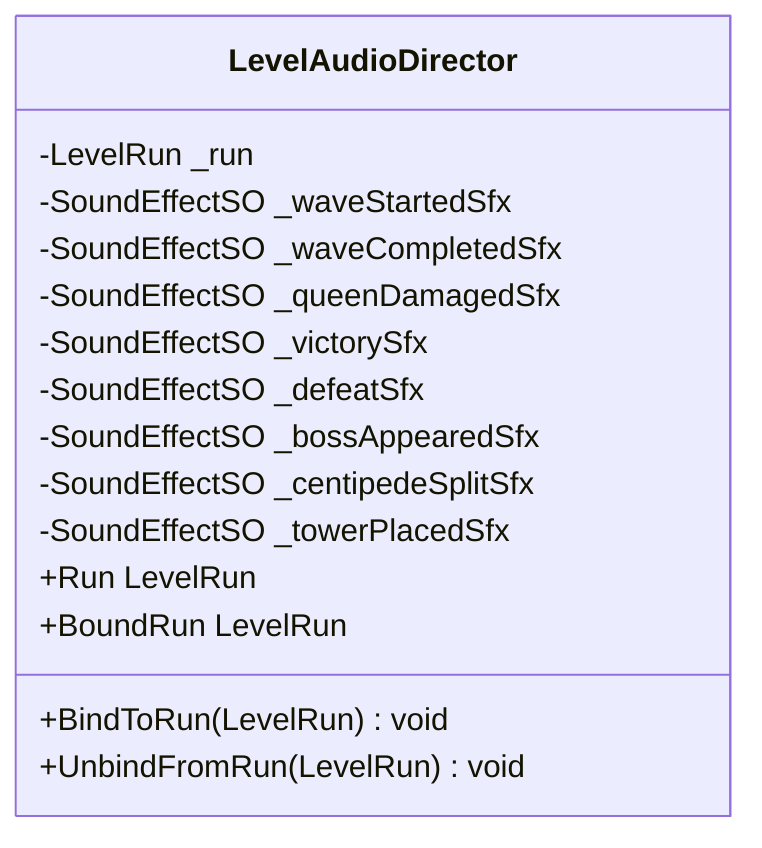

# Technical Documentation: LevelAudioDirector.cs (Macro Game Flow Audio Director)

**Target Unity Version**: Unity 6 (`6000.6.0f1`)  
**Context**: 2D Hybrid Tower Defense Game (*Hold the Hill*)  
**File Location**: `unity/Assets/_Game/Features/GameFlow/Scripts/LevelAudioDirector.cs`  
**Namespace**: `HoldTheHill.Features.GameFlow`  
**Assembly**: `HoldTheHill.Runtime`  
**Test Suite**: `unity/Assets/_Game/Tests/EditMode/LevelAudioDirectorTests.cs`  
**Companion Systems**:
- `LevelRun.cs` (`_Game/Features/GameFlow/Scripts/`) — run management hub and event aggregator
- `Queen.cs` (`_Game/Features/GameFlow/Scripts/`) — hill health and game-over state
- `EnemySpawner.cs` (`_Game/Features/Enemies/Scripts/EnemySpawner/`) — wave start/completion events
- `CentipedeEnemy.cs` / `QueenMantisBoss.cs` (`_Game/Features/Enemies/Scripts/`) — boss and split enemy events
- `TowerPlacer.cs` (`_Game/Features/Towers/Scripts/`) — grid placement events
- `SoundEffectSO.cs` (`_Game/Core/Audio/`) — audio event definitions
- `AudioManager.cs` (`_Game/Core/Audio/`) — audio voice pool and playback service

---

## 1. Overview & Architecture

`LevelAudioDirector` acts as the **macro-level audio observer** for game runs in *Hold the Hill*. It bridges high-level gameplay state transitions (waves, Queen health alarms, run outcomes, boss arrivals, and tower placements) with the audio playback system, completely decoupled from core game simulation logic.

### Architectural Placement: Why `Features/GameFlow`?

Per the project architecture rules in `AGENTS.md` and `README.md`:
> *"Gameplay code lives in `unity/Assets/_Game/Features/<Feature>/`. `Core/` never depends on `Features/`."*

Because this director observes `LevelRun`, `EnemySpawner`, `Queen`, and boss scripts (which are all feature-level gameplay systems), placing the director in `_Game/Core/Audio/` would have forced `Core/` to depend on `Features/`. 

Placing `LevelAudioDirector` in **`_Game/Features/GameFlow/Scripts/`** preserves clean architectural layering: `Features/GameFlow` consumes `Core/Audio` (`SoundEffectSO`), but `Core/` remains 100% independent.

---

## 2. Inspector Configuration & Fields

| Field | Type | Default | Description |
| :--- | :--- | :--- | :--- |
| `_run` | `LevelRun` | `null` | Optional direct reference to the level run. If unassigned, automatically subscribes to `LevelRun.Started`. |
| `_waveStartedSfx` | `SoundEffectSO` | `null` | Triggered when a wave begins (`onWaveStarted`). |
| `_waveCompletedSfx` | `SoundEffectSO` | `null` | Triggered when a wave completes (`onWaveCompleted`). |
| `_queenDamagedSfx` | `SoundEffectSO` | `null` | Triggered when the Queen's health drops (`OnHealthChanged` where $\Delta \text{HP} < 0$). |
| `_victorySfx` | `SoundEffectSO` | `null` | Triggered when the run outcome is `RunOutcome.Victory`. |
| `_defeatSfx` | `SoundEffectSO` | `null` | Triggered when the run outcome is `RunOutcome.Defeat`. |
| `_bossAppearedSfx` | `SoundEffectSO` | `null` | Triggered when a boss appears (`QueenMantisBoss.Appeared`). |
| `_centipedeSplitSfx` | `SoundEffectSO` | `null` | Triggered when a centipede segment splits (`OnAnyCentipedeSplit`). Spatialized at the split position. |
| `_towerPlacedSfx` | `SoundEffectSO` | `null` | Triggered when a tower is placed (`TowerPlacer.TowerPlaced`). Spatialized at the tower position. |

---

## 3. Runtime API & Lifecycle Management

### Dual Binding Modes
1. **Explicit Scene Mode:**
   If `_run` is serialized in the Inspector (e.g. attached directly to the `Level Run` object in a level's gameplay scene), it binds directly to that `LevelRun` instance on `OnEnable()`.
2. **Dynamic Observer Mode:**
   If `_run` is unassigned (e.g. placed in the persistent `UI` scene), it listens to `LevelRun.Started` and binds dynamically as each level is loaded additively. When `LevelRun.Ended` fires upon scene unload, it unbinds cleanly.

### Memory Leak Prevention
Subscribing to C# events across multi-scene transitions carries the risk of stale event listeners keeping unloaded scenes in memory. `LevelAudioDirector` cleanly unregisters all listeners in:
* `HandleRunEnded(LevelRun run)`
* `UnbindFromRun(LevelRun run)`
* `OnDisable()`

---

## 4. Scene Integration Guide

### Option 1: Attach to `Level Run` (Recommended for Level Builders)
Attach `LevelAudioDirector` directly to the `Level Run` GameObject in `L00_TutorialHill_Gameplay.unity` and `L01_Meadow_Gameplay.unity`. Drag the `LevelRun` component into the `_run` slot and assign the respective `SoundEffectSO` assets.

### Option 2: Add to Persistent `UI` Scene
Attach `LevelAudioDirector` to an empty GameObject in `Scenes/UI`. Leave `_run` unassigned. It will automatically detect every level that opens via `LevelRun.Started` and unhook when levels change or restart.

---

## 5. Unit Testing & Verification

The director's behavior is verified by [LevelAudioDirectorTests.cs](file:///c:/Users/metal/Documents/GitHub/HoldtheHill/HoldtheHill/unity/Assets/_Game/Tests/EditMode/LevelAudioDirectorTests.cs):

| Test Case | Description |
| :--- | :--- |
| `Director_Fields_AreAssignedCorrectly` | Verifies that all `SoundEffectSO` properties can be assigned and read. |
| `BossAppeared_PlaysBossAppearedSfx` | Verifies boss appearance event triggers playback. |
| `Disabled_Director_DoesNotListenToStaticEvents` | Verifies that disabling the component cleans up listeners and prevents zombie event processing. |
| `UnbindFromRun_HandlesNullSafely` | Asserts null-safety when unbinding from null runs or uninitialized states. |
