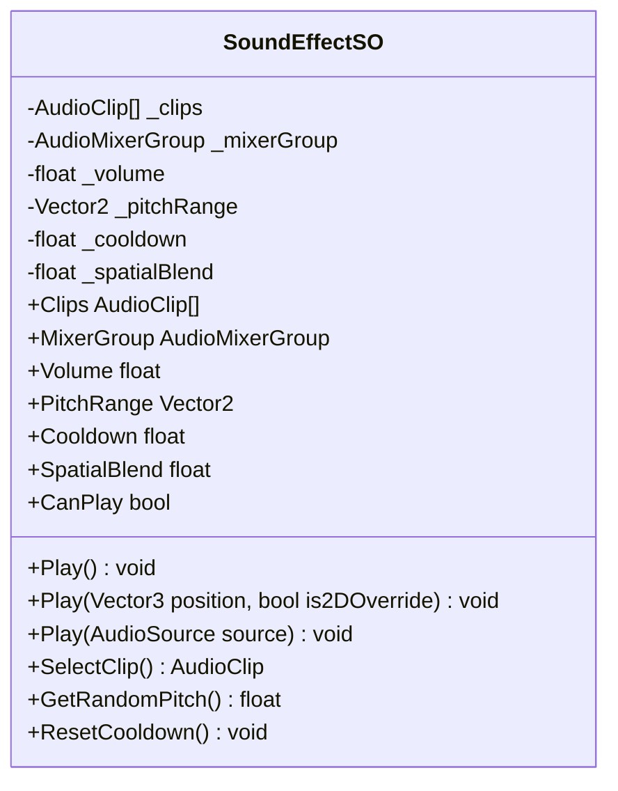

# Technical Documentation: SoundEffectSO.cs (Audio Event ScriptableObject)

**Target Unity Version**: Unity 6 (`6000.6.0f1`)  
**Context**: 2D Hybrid Tower Defense Game (*Hold the Hill*)  
**File Location**: `unity/Assets/_Game/Core/Audio/SoundEffectSO.cs`  
**Namespace**: `HoldTheHill.Core.Audio`  
**Assembly**: `HoldTheHill.Runtime`  
**Test Suite**: `unity/Assets/_Game/Tests/EditMode/SoundEffectSOTests.cs`  
**Companion Systems**:
- `AudioManager.cs` (`_Game/Core/Audio/`) — central pooled playback engine and AudioMixer manager
- `EnemyHurtAndDeath.cs` (`_Game/Features/Enemies/Scripts/Animation/`) — enemy damage & death sound triggers
- `Tower.cs` / `Projectile.cs` (`_Game/Features/Towers/`, `_Game/Features/Combat/`) — weapon firing & impact audio
- `HazardScheduler.cs` (`_Game/Features/Hazards/Scripts/`) — hazard telegraph audio

---

## 1. Overview & Architecture

`SoundEffectSO` is a **ScriptableObject-based audio event architecture**. Rather than requiring gameplay scripts to directly reference and play raw `.wav` or `.ogg` `AudioClip` files via local `AudioSource` components, game systems reference a `SoundEffectSO` asset.

This asset encapsulates **how** a sound should be played: its volume, random pitch variance, clip variations, routing bus (AudioMixer group), 2D/3D spatial blend, and minimum re-trigger cooldown.

```mermaid
flowchart TD
    subgraph Callers["Audio Callers (Features)"]
        Tower["Tower / Projectile\n(Shoot, Hit)"]
        Enemy["EnemyHurtAndDeath\n(Hurt, Squash)"]
        Hazard["BirdShadow / Hazard\n(Warning Screech)"]
        UI["UI Buttons / HUD\n(Click, Error)"]
    end

    subgraph SoundAsset["SoundEffectSO (Asset Card)"]
        SO["SoundEffectSO.asset\n• AudioClip[] _clips (Variations)\n• Vector2 _pitchRange (Jitter)\n• float _volume (Gain)\n• float _cooldown (Anti-spam)\n• AudioMixerGroup _mixerGroup\n• float _spatialBlend (2D vs 3D)"]
    end

    subgraph PlaybackLayer["Playback Delegation"]
        Handler{"PlaybackHandler != null?"}
        AudioManager["AudioManager Pool\n(Zero GC, AudioMixer routing,\nvoice stealing, pooled AudioSources)"]
        Fallback["PlayFallback / Direct AudioSource\n(AudioSource.PlayClipAtPoint or\ncustom AudioSource)"]
    end

    Tower -->|Play(worldPos)| SO
    Enemy -->|Play(worldPos)| SO
    Hazard -->|Play()| SO
    UI -->|Play()| SO

    SO --> Handler
    Handler -->|Yes (Normal Runtime)| AudioManager
    Handler -->|No (Tests / Standalone)| Fallback
```

### Architectural Pillars

1. **Decoupled Data Architecture:**
   Sound configuration is completely separated from gameplay logic. Designers and artists can tune volumes, swap `.wav` files, or adjust pitch variation in the Inspector without recompiling C# code or modifying prefabs.
2. **Anti-Cacophony Throttling (Cooldown):**
   In a 2D tower defense game with 30+ enemies on screen, rapid-fire towers can cause dozens of identical impact hits in a single frame. `SoundEffectSO` enforces a configurable cooldown (e.g. $0.05\text{s}$) that prevents audio clipping, blown-out volume spikes, and voice-pool exhaustion.
3. **Organic Variation via Micro-Pitch Jitter:**
   By randomly jittering pitch between $0.95$ and $1.05$ and cycling between clip variations without immediate repetition, a single sound effect avoids sounding robotic without loading dozens of audio files into memory.
4. **Zero Garbage Collection (`GC.Alloc`):**
   Calls to `Play()` delegate to pre-warmed, pooled `AudioSource` instances managed by `AudioManager`, preventing runtime allocations and frame drops.
5. **Standalone / Test Friendly:**
   If `AudioManager` is absent (such as in EditMode tests or sandbox scenes), `SoundEffectSO` can play directly through any provided `AudioSource` via `Play(AudioSource)` or fall back safely.

---

## 2. Inspector Configuration & Fields

Assets are created in the Project view via **Assets > Create > Hold the Hill > Audio > Sound Effect** (default prefix `sfx_`).



| Field | Type | Default | Range / Constraints | Description |
| :--- | :--- | :--- | :--- | :--- |
| `_clips` | `AudioClip[]` | `Empty` | `AudioClip` array | Array of clip variations. If multiple are provided, `SelectClip()` picks randomly without playing the same clip twice in succession. |
| `_mixerGroup` | `AudioMixerGroup` | `null` | Asset reference | Target `AudioMixerGroup` (e.g. `Master`, `SFX`, `UI`, `Music`). Directs audio to user-adjustable volume buses. |
| `_volume` | `float` | `1.0` | `[Range(0f, 1f)]` | Master gain multiplier for this sound event. |
| `_pitchRange` | `Vector2` | `(0.95, 1.05)` | Min/Max pitch | Pitch jitter bounds centered around $1.0$. A range of $[0.95, 1.05]$ represents a subtle $\pm 5\%$ variation. |
| `_cooldown` | `float` | `0.05` | `[Min(0f)]` | Minimum elapsed time (in unscaled seconds) before this sound event can play again. Skips spam calls. |
| `_spatialBlend` | `float` | `0.0` | `[Range(0f, 1f)]` | `0.0` is pure 2D stereo (UI, global alerts); `1.0` is full 3D spatial panning. Typical combat uses `0.0` to `0.35`. |

---

## 3. Runtime API Reference

### Public Methods

#### `void Play()`
Plays the sound effect in **2D stereo mode** (`is2DOverride = true`). Ideal for UI clicks, wave start/end chimes, and global game alerts.
```csharp
[SerializeField] private SoundEffectSO _waveStartSfx;

// Inside Spawner or Audio Director:
_waveStartSfx.Play();
```

#### `void Play(Vector3 position, bool is2DOverride = false)`
Plays the sound effect at a specific world coordinate with the asset's configured `SpatialBlend`.
```csharp
[SerializeField] private SoundEffectSO _hitSfx;

// Inside projectile impact or enemy damage:
_hitSfx.Play(transform.position);
```

#### `void Play(AudioSource source)`
Directly configures and triggers the sound effect on the provided `AudioSource`. Configures clip, mixer group, volume, pitch, and spatial blend. Useful for dedicated object emitters (e.g., continuous engine hums or sandbox tests).
```csharp
[SerializeField] private SoundEffectSO _shootSfx;
[SerializeField] private AudioSource _localSource;

_shootSfx.Play(_localSource);
```

#### `AudioClip SelectClip()`
Selects a clip from `_clips[]`. If multiple clips exist, it avoids picking the identical clip index played on the previous invocation. Returns `null` if `_clips` is empty.

#### `float GetRandomPitch()`
Computes a randomized pitch scalar between `_pitchRange.x` and `_pitchRange.y`. If min $\ge$ max, returns the minimum bound directly.

#### `void ResetCooldown()`
Resets internal tracking timestamps (`_lastPlayTime = -1000f`, `_lastClipIndex = -1`). Primarily used in unit tests and scene transitions.

---

### Static Delegation Hook

#### `public static Action<SoundEffectSO, Vector3, float> PlaybackHandler`
The centralized bridge between all `SoundEffectSO` assets and the active audio engine:
* When `AudioManager` wakes up, it registers itself:
  ```csharp
  SoundEffectSO.PlaybackHandler = (sfx, pos, blend) => PlayOneShot(sfx, pos, blend);
  ```
* When `PlaybackHandler` is assigned, all calls to `Play()` bypass local allocation and use the pooled voice manager.
* A `[RuntimeInitializeOnLoadMethod(RuntimeInitializeLoadType.SubsystemRegistration)]` hook automatically clears `PlaybackHandler` when reloading domain or resetting playmode state to eliminate static memory leaks.

---

## 4. System Integration Examples

### Example A: Tower Projectile Firing
```csharp
using HoldTheHill.Core.Audio;
using UnityEngine;

namespace HoldTheHill.Features.Towers
{
    public class ArrowTower : MonoBehaviour
    {
        [Header("Audio")]
        [SerializeField] private SoundEffectSO _shootSfx;

        public void Fire(Vector3 targetPosition)
        {
            // Spawn arrow projectile...

            // Play firing sound at tower's location
            if (_shootSfx != null)
            {
                _shootSfx.Play(transform.position);
            }
        }
    }
}
```

### Example B: Enemy Damage and Death Feedback
```csharp
using HoldTheHill.Core.Audio;
using UnityEngine;

namespace HoldTheHill.Features.Enemies
{
    public class EnemyFeedback : MonoBehaviour
    {
        [SerializeField] private SoundEffectSO _hurtSfx;
        [SerializeField] private SoundEffectSO _deathSfx;

        public void OnDamaged(float damage)
        {
            _hurtSfx?.Play(transform.position);
        }

        public void OnDied()
        {
            _deathSfx?.Play(transform.position);
        }
    }
}
```

### Example C: UI Button Audio Trigger
```csharp
using HoldTheHill.Core.Audio;
using UnityEngine;
using UnityEngine.UI;

namespace HoldTheHill.Features.UI
{
    [RequireComponent(typeof(Button))]
    public class UIButtonAudio : MonoBehaviour
    {
        [SerializeField] private SoundEffectSO _clickSfx;

        private void Awake()
        {
            GetComponent<Button>().onClick.AddListener(OnClick);
        }

        private void OnClick()
        {
            _clickSfx?.Play(); // 2D full stereo
        }
    }
}
```

---

## 5. Unit Testing & Verification

The asset behavior is validated by the EditMode test suite [SoundEffectSOTests.cs](file:///c:/Users/metal/Documents/GitHub/HoldtheHill/HoldtheHill/unity/Assets/_Game/Tests/EditMode/SoundEffectSOTests.cs):

| Test Case | Method Verified | Description |
| :--- | :--- | :--- |
| `SelectClip_ReturnsNull_WhenEmpty` | `SelectClip()` | Asserts safe handling when `_clips` is null or zero-length. |
| `SelectClip_ReturnsSingleClip_WhenOnlyOneProvided` | `SelectClip()` | Asserts correct return when exactly 1 clip is assigned. |
| `GetRandomPitch_ReturnsValueWithinRange` | `GetRandomPitch()` | Verifies 20 consecutive samples stay within `[pitchMin, pitchMax]`. |
| `Play_InvokesPlaybackHandler_WithCorrectParameters` | `Play(Vector3)` | Confirms world position, spatial blend, and asset reference route to `PlaybackHandler`. |
| `Play2D_OverridesSpatialBlendToZero` | `Play()` | Confirms 2D convenience overload forces spatial blend to `0.0`. |
| `Cooldown_PreventsImmediateConsecutivePlays` | `CanPlay` | Calls `Play()` twice in the same frame; asserts only the first call triggers playback. |
| `PlayAudioSource_ConfiguresAndPlaysSource` | `Play(AudioSource)` | Verifies direct application of clip, volume, pitch, and spatial blend to an `AudioSource`. |

